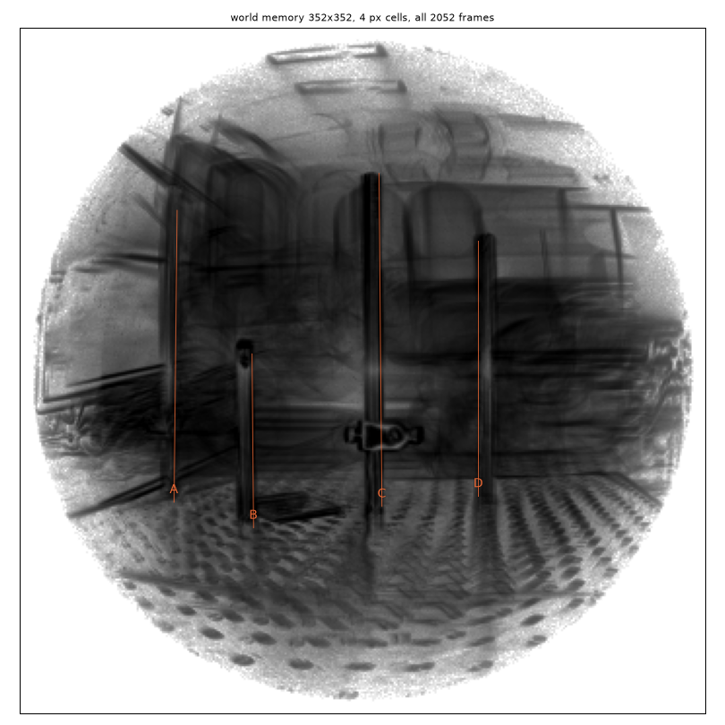
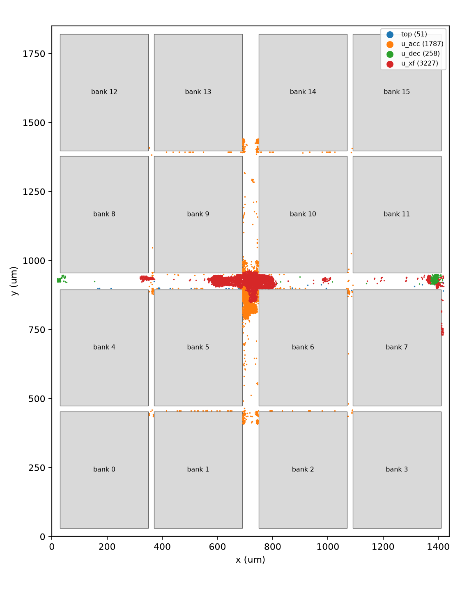

# Pixel-to-World 매핑 & 월드 메모리 누적 엔진

> 회전하는 이벤트 카메라(DVS)를 위한 ASIC 처리 엔진이다. 960 × 720 픽셀 배열의 이벤트를
> 카메라 회전을 되돌려 월드 좌표로 매핑하고, 칩 안의 352 × 352칸 월드 메모리에 세어 쌓는다. GPDK045
> 200 MHz에서 배치 · 배선까지 타이밍을 닫았고, 출력은 정수 골든 모델과 비트 단위로 같다.

이벤트 카메라는 밝기가 바뀐 픽셀만 보낸다. 그래서 카메라가 돌면 장면의 모든 모서리에서 이벤트가 쏟아진다.
이 설계는 센서의 **원시 32비트 MGROUP 워드를 그대로** 받아 프레임마다 회전각을 되돌린다. 그래서 카메라가
374° 돌아도 정지한 물체는 월드 메모리의 같은 칸에 쌓인다. 센서 형식이 가진 계층(프레임 → 열 → 8행 묶음)을
연산 재사용에 쓰고, 같은 칸에 연달아 오는 갱신을 합친다. 그 결과 같은 조건의 이벤트 단위 기준 설계보다 로직
면적이 **1/1.91**, 이벤트당 로직 에너지가 **1/2.43**이고, 월드 메모리 SRAM 면적은 처음 구성의 **38 %**다.

전국 대학생 AI반도체 회로설계 경진대회 2차 과제다. 1차 과제도 함께 담았다. 1차에서는 이벤트 센서가 픽셀을
읽어 내는 방식을 분석하고 개선된 AER readout 구조를 Verilog로 제안했다
([`round1-aer/`](#1차-과제-aer-readout-round1-aer)).

[English](README.md)



*374° 녹화의 2,052 프레임을 각각 되돌려 겹친 결과. 수직 막대 네 개(A ~ D)가 곧고(기울기 ≤ 0.6°)
제자리에 있다(≤ 2 px).*

---

## 배경

2026 전국 대학생 AI반도체 회로설계 경진대회 디지털 부문 2차 과제다. 주최 측 주제는 "n×m 픽셀의 시각
정보를 N×M 메모리로 mapping하는 회로, pixel coordinate → world coordinate 변환, 센서는 고정된 위치에서
방향만 바꾼다"였다.

| | |
|---|---|
| 센서 | NRV Delta-01(Samsung S5KRC1S), 960 × 720, 약 1,290 fps(프레임 간격 775 ~ 777 µs) |
| 입력 형식 | MGROUP: 열 주소 하나 뒤에 그 열의 8행 비트맵, 시각은 프레임마다 하나 |
| 운동 | 회전만(roll · yaw 각각 180° 이내), 이동 없음 |
| 정답 | 없음. 검증 방법을 팀이 정해야 함 |
| 공정 | GPDK045 표준 셀, **SRAM 컴파일러 없음**. "있다고 상정하고 설명하라", 그래도 SRAM 면적 · 전력은 평가 |
| 녹화 | 3개, 각 약 1.59초. 설계 대상 장면 1 = 2,052 프레임, 88,075,135 이벤트, roll 약 374° |

센서 설계자는 이벤트마다 µs 타임스탬프를 붙이면 전송 대역폭을 다 잡아먹어서 MGROUP을 만들었다. 시각은
프레임마다, 주소는 열마다 한 번만 보내 같은 대역폭에서 이벤트를 4 ~ 40배 더 보낸다. 이 프로젝트는 같은
묶음 구조를 전송만이 아니라 **연산과 메모리 접근**을 줄이는 데에도 썼다.

## 시스템

```
in_word (32비트 원시 MGROUP 워드, valid/ready) ─┐
ph_data (16비트 회전 위상, 프레임마다 하나)     ─┼─> wl_top
cx, cy  (회전 중심, 고정)                      ─┘

wl_decode ──작업──> wl_xform ──칸──> wl_accum ──> 1RW SRAM 뱅크 16개
 COL/GRP/BND        S1 → X → E1 → E2     P → R → W
                    wl_cordic (프레임마다)  합치기 + 뱅크 RMW + 포화
                    wl_region_map          wl_region_map
```



```
w = R(ψ_f) · (p − c) + WC        프레임마다 2차원 회전 하나(roll), WC = 704 px
월드 메모리: 4 × 4 px 칸 352 × 352개, 13비트 포화 카운터, 이벤트가 닿는 원 영역만 저장
```

회전각은 칩 밖에서 받는다. `.dvs`에는 각도가 없고, 영상에서 각도를 추정하는 것은 별도의 무거운 문제다.
이 프로젝트에서는 SW 추적기가, 실제 시스템에서는 자이로가 공급한다.

## 설계

### 1. 원시 형식 역해석

제조사 SDK는 `.dvs`를 이벤트 목록으로 바꿔 주는 컴파일된 `.so`일 뿐이고 비트 배치를 공개하지 않는다.
그런데 칩은 원시 워드를 직접 풀어야 하고, 연산 재사용은 SDK가 버리는 워드 구조 자체를 쓴다.
`sdk_dump.cpp`로 SDK의 문서화되지 않은 함수를 호출해 결과를 뽑았다. 그 결과와 원시 워드를 맞대어 파서
`dvs_read.py`를 썼고, `check_sdk.py`로 프레임마다 대조했다. 결과는 **녹화 3개, 2.5억 이벤트에서 다른 이벤트
0개**다. 같은 규칙이 RTL 디코더가 되었다. 예를 들어 "프레임 카운터가 바뀔 때만 경계"라는 규칙은 `wl_decode`의
한 줄이다.

### 2. Computation reuse ① cos · sin은 프레임마다 한 번

한 프레임의 이벤트(평균 약 4.3만 개)는 각도 하나를 공유한다. 이벤트 단위 설계가 쓰는 16단 펼친 CORDIC
대신 **반복형 CORDIC** 하나를 프레임마다 한 번 돌린다. 18클럭으로, 200 MHz에서 프레임당 약 15.5만 클럭 중
일부다. `cur`/`nxt` 레지스터 쌍으로 다음 프레임 각도를 미리 구해 두고, 다음 각도가 없으면 옛 각도로
처리하지 않고 멈춘다. cos · sin 계산은 88,075,135회에서 **2,052회**로 준다. 위상 65,536개 전부에서 오차는
1.92 LSB 이하다.

### 3. Computation reuse ② 곱셈을 열 / 묶음 / 이벤트로 나누기

```
열 주소마다   Xu = C·(x − cx) + WC·2^14,  Xv = S·(x − cx) + WC·2^14     곱셈 2
8행 묶음마다  Bu = Xu − S·(y0 − cy),      Bv = Xv + C·(y0 − cy)         곱셈 2
이벤트마다    u  = Bu − k·S,              v  = Bv + k·C   (k = 0..7)    시프트 · 덧셈만
```

이벤트당 곱셈은 **4.00 → 1.14회**, 곱셈기는 4개 → 2개다. 근사가 아니라 정수 덧셈의 순서만 바꾼 것이라
이벤트마다 계산한 결과와 비트 단위로 같다.

### 4. Update aggregation + 1RW SRAM 뱅크 16개

이벤트당 에너지의 76 %가 SRAM이다. 장면 1에서 이벤트의 **27.3 %**가 바로 앞 이벤트와 같은 칸에 떨어진다.
그래서 누적 블록은 모으는 칸 하나를 들고 개수만 세다가, 칸이 바뀔 때 `+n`을 한 번에 쓴다. 레지스터 하나로
열 단위 버퍼(28.5 %)의 감소를 거의 다 얻는다.

연속 갱신이 이제 늘 *다른* 칸이므로, 2포트 1R1W SRAM을 좌표 아래 2비트로 나눈(`bank = {wy[1:0], wx[1:0]}`)
**1포트 1RW 뱅크 16개**로 바꿀 수 있다. 맞닿은 칸은 언제나 다른 뱅크라 한 뱅크의 읽기와 다른 뱅크의 쓰기가
같은 클럭에 된다. forwarding 경로는 필요 없다.

| 구성 (프레임 500 ~ 539, 285만 이벤트) | 클럭 수 |
|---|---:|
| **합치기 + 뱅크 16 (채택)** | **2,888,024** |
| 합치지 않음 + 뱅크 16 | 3,762,249 (+30 %) |
| 합치지 않음 + 뱅크 4 | 3,958,433 (+37 %) |
| 합치기 + 뱅크 64 | 2,873,362 (−0.5 %) |

이벤트당 SRAM 접근은 2.00 → **1.45회**이고, 장면 1 전체에서 이상적인 1R1W 대비 클럭은 +1.6 %뿐이다.

### 5. 메모리 크기 줄이기

- **이벤트가 닿는 원만 저장.** 회전 중심에서 가장 먼 픽셀이 677.4 px라 정사각형 월드 메모리의 귀퉁이에는
  이벤트가 절대 오지 않는다. 반지름 696 px 원에 걸치는 칸만 둔다(123,904 → 98,112칸). 주소는 88줄 ROM
  `{오프셋, 시작, 끝}`으로 덧셈 한 번에 낸다.
- **13비트 포화 카운터.** 막대 측정을 바꾸지 않는 가장 작은 폭이다. 포화 칸은 12개(이벤트 0.01 %)이고,
  12비트로 내리면 막대 C의 가장자리가 12 px 넓어진다.

| 단계 | SRAM 면적 (OpenRAM FreePDK45 가정치) |
|---|---:|
| 1R1W 하나, 14비트, 정사각형 | 5.51 mm² |
| + 1RW 뱅크 16개 | 2.77 mm² |
| + 원 영역 | 2.22 mm² |
| + 13비트 | **2.10 mm² (38 %)** |

### 6. 정답 없는 과제의 해석

- **회전 중심.** 센서가 회전축에서 약간 비켜 있어 가까운 물체와 먼 물체가 서로 다른 중심으로 도는 것처럼
  보인다. 배경이 날카로워지는 중심을 쓰면 반 바퀴쯤에서 막대 B ~ D가 4° 안팎 기울었다. 좌표 이동과 각도
  추적 **둘 다 막대 기준 중심**으로 맞추자 이 기울기가 사라졌다. 45° 구간별 기울기 폭이 4.2 ~ 5.9°에서
  1.7 ~ 1.9°로 줄었다.
- **렌즈 보정은 시험한 뒤 넣지 않았다.** 막대마다 최적 k1의 부호가 갈리고, 공통 k1은 직선 잔차를 5 %만
  줄였으며, 보정해서 다시 쌓으면 모두 보정 안 한 것보다 나빴다. roll에서는 왜곡 중심과 회전 중심이 가까워
  왜곡된 점도 같은 원 위를 돌기 때문이다.
- **그 밖에 수치로 시험하고 버린 대안**: 더 작은 칸(메모리 4 ~ 11배에 막대는 5 px 이하 개선), 노이즈 필터
  (막대 그대로, 월드 메모리보다 큰 메모리 필요), 로그 카운터(결과가 난수 시작값에 좌우), 프레임별 회전 중심
  (RTL을 만들어 시험 18개를 통과했지만 정확도가 나아지지 않음).

## 검증

정답 좌표가 없어서 검증을 둘로 나눴다.

**변환이 맞는가.** 장면의 수직 막대 네 개는 곧고 제자리여야 한다. 거의 돌지 않은 45 프레임 구간(약 2°)을
기준으로 두고 374° 전체 누적과 비교했다.

| 막대 | 기울기(짧은 구간 / 전체) | 위치 변화 | 가장자리 반치폭(짧은 → 전체) |
|---|---|---:|---|
| A | −0.5° / −0.6° | 0 px | 12 → 24 px |
| B | +0.3° / +0.5° | +1 px | 4 → 12 px |
| C | −0.0° / +0.5° | −1 px | 4 → 8 px |
| D | −1.4° / −0.0° | +2 px | 8 → 12 px |

**회로가 사양대로 계산하는가.** 단계마다 앞 단계와 합계가 아니라 **칸 하나하나**를 비교했다.

```
제조사 SDK ─(이벤트 0개 차이)→ 파서 → 골든 모델 ─(123,904칸 전부)→ RTL ─(LEC 667점 + GLS)→ 합성 넷리스트 → P&R 넷리스트
```

| 시험 | 결과 |
|---|---|
| CORDIC, 위상 65,536개 전부 | 불일치 0 (Verilator, xsim) |
| 장면 1 전체, 이벤트 8,800만 개 | 123,904칸 모두 골든과 같음 |
| 장면 2 전체 (다른 셋업, `cx, cy`만 바꿈) | 모든 칸 같음 |
| 회귀 시험 16개 | 워드 사이 빈 클럭, 8비트 포화, 합치기 끔 / 폭 2, 원 밖 이벤트를 골든과 똑같이 버림, 열 주소 없이 시작하는 파일, 빈 프레임, 기준 설계 |
| 합성 뒤 / P&R 뒤 | Conformal LEC 등가(출력 57, 플립플롭 594, SRAM 16), 게이트 레벨 시뮬레이션 일치 |

## 결과

GPDK045(gsclib045). 셋업은 slow 코너 0.9 V / 125 °C, hold는 fast 코너 1.1 V / 0 °C, 목표 200 MHz.
Genus · Innovus 23.14, Conformal LEC 24.10, Xcelium 23.09.

| | 합성 | 배치 · 배선 뒤 |
|---|---|---|
| 타이밍 | slack +5.9 ps | **셋업 +65 ps, hold +31 ps, 위반 0** |
| 로직 면적 | **11,081 µm²** (셀 4,412) | 13,071 µm² (셀 5,323) |
| 활동 중 로직 전력 (VCD) | **0.432 mW** | 0.594 mW |
| 이벤트당 로직 에너지 | **2.20 pJ** | 3.02 pJ |
| 다이 | | 1,440 × 1,851 µm = 2.665 mm², 그중 SRAM 뱅크 자리 81 % |
| 검사 | LEC, GLS | LEC, GLS, DRC · 연결 위반 0 |

| 처리율 | |
|---|---|
| 장면 1 전체 이벤트당 클럭 | **1.03** |
| 정상 프레임 중 최대(85,194 이벤트) | 한 프레임 간격 안에 끝내려면 111.1 MHz 필요 |
| 열을 두 번 훑은 예외 프레임(125,806 이벤트) | 164.2 MHz 필요 |
| 설계 클럭 | 200 MHz. 1.8배 여유, 1.59초 녹화를 0.45초에 처리 |

**이벤트 단위 기준 설계와 비교.** 기준 설계 `wl_base_top`은 이벤트마다 (x, y, 위상) 36비트를 받고,
펼친 16단 CORDIC과 곱셈기 4개를 쓴다. 누적 블록 · SRAM · 코너 · 클럭 · clock gating은 같게 맞췄고, 위상을
직접 줘서 기준 설계에 유리하게 했다.

| | 이 설계 | 기준 설계 | 비율 |
|---|---:|---:|---|
| 로직 면적 | 11,081 µm² | 21,205 µm² | **1/1.91** |
| 이벤트당 로직 에너지 | 2.20 pJ | 5.33 pJ | **1/2.43** |
| SRAM 포함 이벤트당 에너지 | 9.25 pJ | 12.38 pJ | **−25 %** |
| 입력 비트 / 이벤트 | 10.1 | 36 | |
| 곱셈 / 이벤트 | 1.14 | 4.00 | |

clock gating만으로 활동 중 전력이 0.725 → 0.432 mW(−40 %)로 줄었다.



*SRAM 뱅크 자리 16개를 4 × 4로 놓고 로직은 가운데 폭 60 µm 십자 통로에 두었다.*

**주장하지 않는 것.** 대회 PDK에 SRAM 컴파일러가 없어서, SRAM 수치는 OpenRAM(FreePDK45) 면적과
CACTI 7(45 nm, 저누설) 에너지로 낸 가정치다. 합성 수치와 섞지 않는다. 게이트 레벨 시뮬레이션은 zero delay로
프레임 500 ~ 539 구간만 돌렸고, 타이밍은 STA로 확인했다. 회전각은 밖에서 받는다. 카메라 하나로는 깊이를
알 수 없어 깊이가 다른 물체는 약간 번진다. 칩은 backpressure로 입력을 늦추므로 실제 센서에는 입력 FIFO가
필요하며, 이 부분은 측정하지 않았다.

## 1차 과제: AER readout (`round1-aer/`)

> Bio-mimic Neuron을 위한 AER(address-event representation) 통신 방식 설계. 전통 AER을 분석해 문제점을
> 찾고 개선된 설계 방향을 제시한다. 2026-08-28 제출.

### 주제 해석

AER은 데이터 포맷과, 픽셀 배열에서 이벤트를 꺼내는 readout 메커니즘의 두 층위를 가리킨다. 과제는 후자다.
픽셀 front-end 잡음이 이미 수백 µs의 시각 불확실성을 만들므로, 타임스탬프 단위를 잘게 하는 것만으로는
나아지지 않는다. 그래서 설계 목표를 **부하가 걸렸을 때의 readout worst-case 지연과 timestamp error**로
다시 정했다.

### 분석

전통 AER의 문제점 10개를 정리했다. unfair arbitration, 다중 핸드셰이크 지연, motion artifact, timestamp
error, overflow, log₂N 중재 지연, redundant event, encoder 부하, metastability, 물리적 상한이다. 그중 4개
(unfair arbitration, timestamp error, 확장성, metastability)는 자체 Verilog 모델로 측정했다.

- **아티팩트는 닫힌 식으로 쓸 수 있다.** 이진 arbiter 트리의 서비스 순서는 주소 공간의 결정론적
  비트역순 `L(ch) = τ₀ + bitrev(ch) · Δ`를 따른다. 특정 채널이 늘 늦게 서비스되는 이유가 이것이다.
- **서로 직교하는 레버 세 개**를 대가와 함께 측정했다.

| 레버 | 효과 | 대가 |
|---|---|---|
| tile 분할 | worst ∝ 1/M, throughput × M | 출력 채널 M개 |
| 중재 공정화 | 서비스 편향 63.00 → 3.24 | 우선순위 상태 로직 |
| 타임스탬프 분리 | 서비스 편향 63.00 → **0.0000** | 저활동 시 T_frame/2 |

- **arbiter와 scan은 교차한다.** 비동기 arbiter 트리는 이벤트율이 낮을 때, 동기 scan은 높을 때 유리하다.
  교차점은 **550 / 780 Meps**로 측정했다.

### 제안 구조

**부하 연동 스냅샷 타임스탬핑 + row/column 버스트 arbiter**(100 % 디지털). 부하가 낮으면 row/column
arbiter처럼 동작한다. 활성 행이 기준 이상이 되면 요청 집합을 고정해 타임스탬프를 한 번 찍고, 행 단위
버스트로 배출한다.

| 구조 | 저부하 σ_ts | 포화 σ_ts | 포화 worst | 용량 [Meps] |
|---|---:|---:|---:|---:|
| flat tree | **0.007 ns** | 40.1 | 232.5 | **539** |
| row/column | 0.042 ns | 61.8 | 403.2 | 538 |
| scan (Gen3 계열) | 34.6 ns | 31.7 | 236.6 | 454 |
| **제안** | 0.042 ns | **17.6** | **144.1** | 519 |

포화 구간에서 row/column보다 timestamp error가 **3.5배**, worst-case 지연이 **2.8배** 낮다. 대가는 용량
**−3.6 %**(538 → 519 Meps)이고, 그래도 scan보다 14 % 높다. 저부하에서는 베이스라인과 같다.

### 검증

- 모든 구조를 비동기 소자(mutex, Muller C-element, matched delay chain)로 만들었다. 소자마다
  **behavioural** 모델(기본)과 **structural** 모델(Earle latch, 준안정 필터가 붙은 cross-coupled NAND,
  버퍼 체인)이 있고 `define`으로 고른다. structural의 용량은 behavioural과 0.01 % 안에서 같았다.
- 스스로 오류를 신고하는 6단계 테스트벤치: 대기, 순차, 버스트, Poisson, 1 ~ 1000 Meps 스윕, 공정성. 자극은
  픽셀당 한 칸 대기(초과분은 소스에서 손실)이고, 제안 구조는 공간 상관 자극(iid, 가로, 세로, 블록)으로도
  시험했다.
- 배출 정합성: 래치 · acknowledge · 배출 수가 같아야 하고(`n_cin = n_ack = n_out`), 픽셀별
  orphan · phantom · spurious 수가 0이어야 한다. 8개 구성 전 구간에서 성립했다.
- 드문 조건에서만 드러나는 결함 3건을 찾아 고쳤다. 가장 어려운 것은 배출 주소의 0.02 %가 어떤 픽셀의
  acknowledge도 없이 나간 문제다. 3자 계수로 좁혀 보니, C-element 전파지연 창 안에서 arbiter 입력 집합이
  바뀌어 이미 확정된 트랜잭션 밑에서 grant가 빠져나간 것이 원인이었다. 정착 게이트를 내리고, C-element
  지연만큼 기다리고, 출력단이 멈출 때까지 기다린 뒤에 집합을 바꾸는 4단계 순서로 고쳤다.

**범위.** Vivado xsim 시뮬레이션 결과다. 지연 값은 구조 사이의 상대 비교이며 실리콘 절대값이 아니다.
1차 시점에는 PDK가 없어 STA와 면적 · 전력 절대값은 하지 못했다.

### 실행 (Vivado / xsim)

```tcl
add_files -norecurse round1-aer/rtl
add_files -fileset sim_1 -norecurse round1-aer/sim
set_property -name {xsim.simulate.runtime} -value {-all} -objects [get_filesets sim_1]

set_property top tb_aer_hybrid [get_filesets sim_1]          ;# TH_ROWS=9 이면 베이스라인
set_property generic {ROW_D=3 COL_D=3 TH_ROWS=4 CLUSTER=0 CL_SIZE=4} [get_filesets sim_1]
launch_simulation

# behavioural 대신 structural 소자로
set_property verilog_define {AER_STRUCT_C AER_STRUCT_MUTEX AER_STRUCT_DLY} [get_filesets sim_1]
```

각 테스트벤치는 마지막에 VERDICT 블록을 낸다. 전체 재현 순서와 파라미터는
[`round1-aer/docs/03_RTL_README.md`](round1-aer/docs/03_RTL_README.md)에 있다.

### 2차와의 연결

1차 보고서는 행 · 열이 분리된 주소와 스냅샷 단위로 묶인 이벤트가 프레임 단위 좌표 변환과 맞물린다고
보았다. 2차에서 실제로 받은 센서 형식 MGROUP도 같은 구조다. 시각은 프레임마다 하나이고, 열 주소 하나 뒤에
행 비트맵이 온다. 2차 칩은 이 구조 위에 만들었다.

## 저장소 구성

```
hardware/src/          RTL: wl_top, wl_decode, wl_xform, wl_cordic, wl_accum, wl_region, wl_sram(시뮬레이션 모델),
                       기준 설계 wl_base_top, 흐름 점검용 smoke_top
hardware/testbench/    tb_worldlock(골든과 칸 단위 비교), tb_base, tb_cordic(전 위상)
hardware/sim/          run_sim.sh, regress.sh, run_gls.sh. results/ = 회귀, 녹화 전체, 뱅크 비교, 프레임별 클럭
hardware/constraints/  SDC
hardware/syn/          Genus · Innovus · Conformal 스크립트, SRAM 블랙박스 wl_sram.lib · wl_sram.lef. results/ = 리포트
hardware/sram/         OpenRAM macro 생성. results/ = OpenRAM · CACTI 가정치
software/dvs_develop/  .dvs 파서, SDK 결과 뽑기와 대조, 입력량 분석
software/golden_develop/  골든 모델 golden.py, 회전각 · 중심 추적, 설계 결정 실험
software/*_data/       위 결과. 실험마다 날짜 붙은 묶음 하나와 설명 .md
docs/design_references/  기술문서 8장
docs/reports/          설계 근거: 결정마다 처음 방법 → 지금 방법 → 숫자
docs/presentation/     대회 발표 자료(20쪽)
round1-aer/rtl/        1차: mutex, c_element, delay_chain, aer_node, aer_tree(8), arb_tree,
                       aer_rowcol, aer_scan, aer_hybrid(제안 구조)
round1-aer/sim/        1차: tb_aer_tree, tb_aer_tree8, tb_aer_rowcol, tb_aer_scan, tb_aer_hybrid
round1-aer/docs/       1차: 설계보고서, RTL 안내, 검증 · 디버깅 기록
```

## 실행

```bash
# 골든 모델과 시험 벡터 (원본 녹화가 필요하며 저장소에는 없음)
python3 software/golden_develop/golden.py <녹화>.dvs <묶음 폴더>

# RTL 회귀 시험 (Verilator 5.x 또는 Vivado xsim). 기본 40 프레임 벡터는 저장소에 있음
hardware/sim/regress.sh

# 대회 서버에서 (Cadence 도구 + GPDK045)
hardware/syn/run_genus.sh wl_top
hardware/syn/run_lec.sh wl_top
hardware/syn/run_innovus.sh wl_top
hardware/sim/run_gls.sh vec500

python3 docs/check_docs.py      # 문서 링크 · 앵커 검사
```

Python은 NumPy, SciPy, Matplotlib을 쓴다. 녹화 전체 벡터(약 250 MB)는 `~/wl_build/` 아래에 만든다. 단계별
설명과 결과 읽는 법은 기술문서 7장에 있다.

## 참고

**팀**: 알이즈웰(대회 ID aiasic26402, 제출 당시 작업명 Event-WorldLock), 2명, 2026.07 ~ 2026.11, 2차 결과 제출 2026-10-30. 분담은 다음과 같다.

- **하드웨어**: RTL(디코더, 반복형 CORDIC, 곱셈 분할 좌표 변환, 합치기 + 1RW 뱅크 16개 누적,
  원 영역 주소 표, clock gating), 이벤트 단위 기준 설계, 테스트벤치와 회귀 시험, Genus 합성, VCD 전력,
  Conformal LEC, 게이트 레벨 시뮬레이션, Innovus 배치 · 배선, SRAM 블랙박스 `.lib` · `.lef`, OpenRAM ·
  CACTI 가정치, 발표 슬라이드
- **알고리즘 · 데이터**: SDK 대조로 `.dvs` 형식 역해석, 파서, 정수 골든 모델, 회전각 · 회전 중심 추적,
  설계 탐색 실험(렌즈, 칸 크기, 노이즈, 칸 비트, 합치기 범위, 저장 영역), 장면 2 · yaw 분석, 제출물 구성

1차 과제는 한 명이 문헌 조사 · Verilog 모델 · 측정 · 디버깅 · 보고서를, 다른 한 명이 발표 자료를 맡았다.

**포함하지 않은 것.** 원본 `.dvs` 녹화 3개(각 약 100 MB)는 주최 측 데이터이고 NRV DELTA SDK는 센서
제조사 배포본이라 다시 배포하지 않는다. 원본 녹화를 읽는 단계는 이 파일들을 따로 받아야 한다.
`sdk_dump.cpp`와 데이터 묶음 설명에 나오는 SDK 경로는 그 외부 설치본을 가리킨다. 대회의 GPDK045
라이브러리와 Cadence 도구는 주최 측 서버에만 있고, 합성 리포트에는 그 서버의 라이브러리 경로가 기록된
그대로 남아 있다. 주석과 문서는 한국어다.
