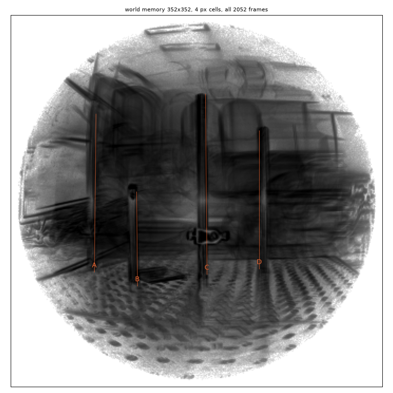
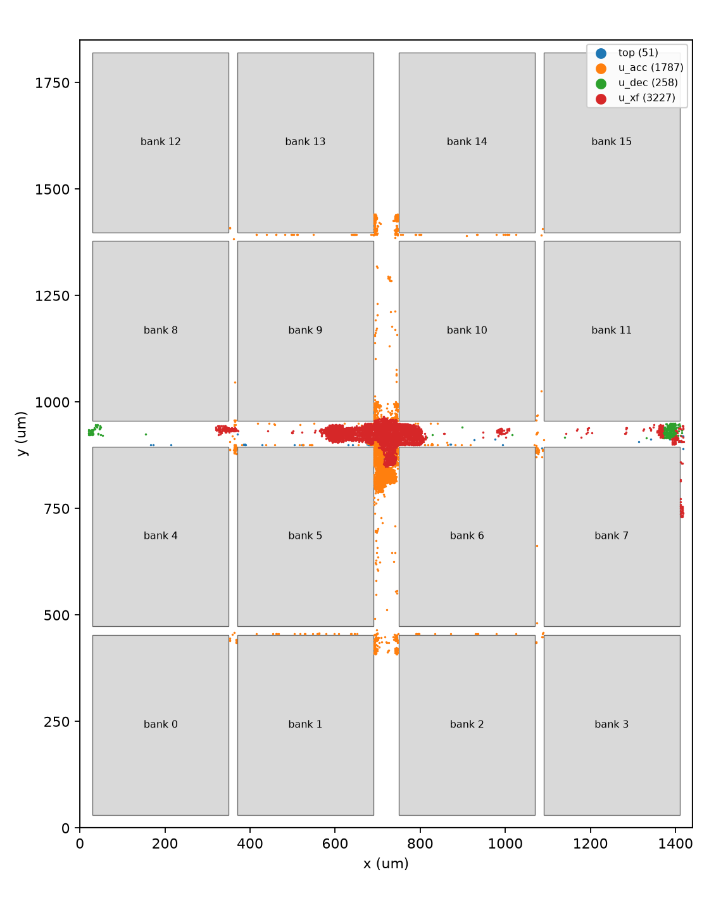

# Pixel-to-World Mapping & World-Memory Accumulation Engine

> An ASIC processing engine for a rotating event camera (DVS). It maps every event from the
> 960 × 720 pixel array to world coordinates, undoing the camera's rotation, and accumulates it in
> a 352 × 352-cell on-chip world memory. It closes timing at 200 MHz in GPDK045 through place-and-route,
> and its output matches the integer golden model bit for bit.

An event camera reports only the pixels whose brightness changed. When the camera turns, every
edge in the scene fires. This design receives the sensor's **raw 32-bit MGROUP words unchanged**
and undoes each frame's rotation angle, so a static object lands in the same world cell even after
the camera has turned 374°. It reuses the sensor format's own hierarchy (frame → column → 8-row
group) for computation. It also merges consecutive updates to the same cell. Against an equally
configured per-event baseline, logic area is **1/1.91** and logic energy per event is **1/2.43**.
World-memory SRAM area is **38 %** of the first configuration.

This was round 2 of a national AI-semiconductor design contest. The repository also holds round 1,
which analysed how an event sensor reads its pixels out and proposed an improved AER readout
architecture in Verilog ([`round1-aer/`](#round-1-aer-readout-round1-aer)).

[한국어](README.ko.md)



*All 2,052 frames of the 374° recording, each rotated back and accumulated. The four vertical
bars (A–D) stay straight (tilt ≤ 0.6°) and in place (≤ 2 px).*

---

## Background

This was the second-round task of the 2026 National University Student AI Semiconductor Circuit
Design Contest (digital track). The organizer's problem statement read: map the visual
information of n×m sensor pixels into an N×M memory, converting pixel coordinates to world
coordinates; the sensor stays in place and only changes direction.

| | |
|---|---|
| Sensor | NRV Delta-01 (Samsung S5KRC1S), 960 × 720, ~1,290 fps (frame interval 775–777 µs) |
| Input format | MGROUP: one column address, then 8-row bitmaps for that column; one timestamp per frame |
| Motion | rotation only (roll and yaw, each within 180°), no translation |
| Ground truth | none, so the team had to define its own verification |
| Process | GPDK045 standard cells, **no SRAM compiler**: "assume one and explain it", but SRAM area and power are still judged |
| Recordings | three, ~1.59 s each; design target scene 1 = 2,052 frames, 88,075,135 events, roll ≈ 374° |

The sensor's designer created MGROUP because per-event microsecond timestamps were eating the link
bandwidth. Sharing one timestamp per frame and one address per column lets the sensor send 4–40×
more events. This project applies the same grouping to **computation and memory access**, not only
to transmission.

## System

```
in_word (32b raw MGROUP word, valid/ready) ─┐
ph_data (16b rotation phase, one per frame) ─┼─> wl_top
cx, cy  (rotation centre, fixed)            ─┘

wl_decode ──task──> wl_xform ──cell──> wl_accum ──> 16 × 1RW SRAM banks
 COL/GRP/BND        S1 → X → E1 → E2      P → R → W
                    wl_cordic (per frame)  merge + bank RMW + saturate
                    wl_region_map          wl_region_map
```



```
w = R(ψ_f) · (p − c) + WC        one 2-D rotation per frame (roll), WC = 704 px
world memory: 352 × 352 cells of 4 × 4 px, 13-bit saturating counters, only the reachable disc stored
```

The rotation angle comes from outside the chip. A `.dvs` file carries no angle, and estimating it
from the images is a separate, heavy problem. In this project a software tracker supplies it; in a
real system a gyro would.

## Design

### 1. Reverse-engineering the raw format

The vendor SDK is a black box: a compiled `.so` that turns a `.dvs` file into an event list and
documents no bit layout. The chip, however, must decode raw words itself, and computation reuse
depends on the word structure that the SDK throws away. `sdk_dump.cpp` calls the SDK's undocumented
entry points. The parser `dvs_read.py` was written by lining raw words up against the SDK output.
`check_sdk.py` then compares the two frame by frame: **0 differing events across all three
recordings (250 M events)**. The same rules became the RTL decoder. One example is the frame-boundary
rule "a boundary only when the frame counter changes", which is a single line in `wl_decode`.

### 2. Computation reuse I: cos/sin once per frame

Every event of a frame shares one angle (about 43 k events per frame). Instead of the unrolled
16-stage CORDIC that a per-event design needs, a single **iterative CORDIC** runs once per frame
(18 cycles out of ~155 k per frame at 200 MHz). A `cur`/`nxt` register pair precomputes the next
frame's cos/sin, and the pipeline stalls rather than process a frame with a stale angle.
cos/sin evaluations drop from 88,075,135 to **2,052**. The worst error over all 65,536 phases is
1.92 LSB.

### 3. Computation reuse II: split the multiplies by column / group / event

```
per column address  Xu = C·(x − cx) + WC·2^14,  Xv = S·(x − cx) + WC·2^14     2 multiplies
per 8-row group     Bu = Xu − S·(y0 − cy),      Bv = Xv + C·(y0 − cy)         2 multiplies
per event           u  = Bu − k·S,              v  = Bv + k·C   (k = 0..7)    shifts and adds only
```

Multiplies per event drop from **4.00 to 1.14**, and the hardware needs 2 multipliers instead of 4.
Nothing is approximated; only the order of integer additions changes, so the output is identical
to per-event computation bit for bit.

### 4. Update aggregation + 16 single-port SRAM banks

76 % of the energy per event goes to SRAM. In scene 1, **27.3 %** of events fall in the same cell as
the previous event. The accumulator therefore holds one pending cell, counts hits on it, and writes
`+n` when the cell changes. A single register gets almost all the benefit of column-level buffers
(28.5 %).

Because consecutive updates now always hit *different* cells, a dual-port 1R1W SRAM can be
replaced by **16 single-port 1RW banks** interleaved on the low two bits of each coordinate
(`bank = {wy[1:0], wx[1:0]}`). Neighbouring cells always sit in different banks, so a read in one
bank overlaps a write in another. No forwarding path is needed.

| Configuration (frames 500–539, 2.85 M events) | Cycles |
|---|---:|
| **merge + 16 banks (chosen)** | **2,888,024** |
| no merge + 16 banks | 3,762,249 (+30 %) |
| no merge + 4 banks | 3,958,433 (+37 %) |
| merge + 64 banks | 2,873,362 (−0.5 %) |

SRAM accesses per event go from 2.00 to **1.45**. Over all of scene 1 the cost is only +1.6 % cycles
against an ideal 1R1W memory.

### 5. Shrinking the memory

- **Store only the reachable disc.** The farthest pixel is 677.4 px from the rotation centre, so
  the corners of the square world memory never receive an event. Only cells touching a 696 px disc
  are stored (123,904 → 98,112 cells). The address comes from an 88-row ROM, `{offset, start, end}`,
  with a single add.
- **13-bit saturating counters**, chosen as the smallest width that leaves the bar measurements
  unchanged: 12 cells saturate (0.01 % of events). At 12 bits, bar C's edge widens by 12 px.

| Step | SRAM area (OpenRAM FreePDK45, assumed) |
|---|---:|
| one 1R1W, 14 bit, full square | 5.51 mm² |
| + 16 × 1RW banks | 2.77 mm² |
| + disc region | 2.22 mm² |
| + 13 bit | **2.10 mm² (38 %)** |

### 6. Interpreting a task with no ground truth

- **Rotation centre.** The sensor sits slightly off the rotation axis, so near and far objects
  appear to rotate about different centres. A background-sharpness centre left bars B–D tilted by
  about 4° half-way round. Using a **bar-based centre for both the coordinate shift and the angle
  tracking** removed it: tilt spread per 45° segment fell from 4.2–5.9° to 1.7–1.9°.
- **Lens correction was tested and rejected.** The best k1 per bar changed sign. The common k1 cut
  line residuals by only 5 %, and every corrected re-run was worse than no correction. With roll,
  the distortion centre and the rotation centre nearly coincide, so distorted points stay on the
  same circle.
- **Other rejected alternatives**, each measured: smaller cells (4–11× memory for ≤ 5 px), a noise
  filter (bars unchanged, needs more memory than the world itself), logarithmic counters (results
  depend on the random seed), and a per-frame rotation centre (RTL built and passing 18 tests, but
  it did not improve accuracy).

## Verification

There are no true coordinates, so verification was split in two.

**Is the transform right?** The four vertical bars in the scene must stay straight and in place.
A near-stationary 45-frame window (~2° of rotation) serves as the reference, and the full 374°
accumulation is compared against it.

| Bar | Tilt (short / full) | Position shift | Edge FWHM (short → full) |
|---|---|---:|---|
| A | −0.5° / −0.6° | 0 px | 12 → 24 px |
| B | +0.3° / +0.5° | +1 px | 4 → 12 px |
| C | −0.0° / +0.5° | −1 px | 4 → 8 px |
| D | −1.4° / −0.0° | +2 px | 8 → 12 px |

**Does the circuit compute the specification?** Every stage is checked against the previous one,
**cell by cell**, not by totals:

```
vendor SDK ─(0 events differ)→ parser → golden model ─(all 123,904 cells)→ RTL ─(LEC 667 points + GLS)→ synthesized netlist → P&R netlist
```

| Check | Result |
|---|---|
| CORDIC, all 65,536 phases | 0 mismatches (Verilator, xsim) |
| Whole scene 1, 88 M events | all 123,904 cells equal the golden model |
| Whole scene 2 (different rig, only `cx, cy` changed) | all cells equal |
| Regression suite (16 runs) | idle cycles between words, 8-bit saturation, merge off / width 2, off-centre events dropped exactly like the golden model, file starting without a column address, empty frames, baseline design |
| After synthesis / after P&R | Conformal LEC equivalent (57 outputs, 594 flops, 16 SRAMs); gate-level simulation matches |

## Results

GPDK045 (gsclib045), setup at slow corner 0.9 V / 125 °C, hold at fast corner 1.1 V / 0 °C, target
200 MHz. Genus / Innovus 23.14, Conformal LEC 24.10, Xcelium 23.09.

| | Synthesis | After place-and-route |
|---|---|---|
| Timing | slack +5.9 ps | **setup +65 ps, hold +31 ps, 0 violations** |
| Logic area | **11,081 µm²** (4,412 cells) | 13,071 µm² (5,323 cells) |
| Active logic power (VCD) | **0.432 mW** | 0.594 mW |
| Logic energy / event | **2.20 pJ** | 3.02 pJ |
| Die | | 1,440 × 1,851 µm = 2.665 mm², 81 % SRAM bank sites |
| Checks | LEC, GLS | LEC, GLS, DRC and connectivity clean |

| Throughput | |
|---|---|
| Cycles per event, whole scene 1 | **1.03** |
| Heaviest normal frame (85,194 events) | needs 111.1 MHz to finish within one frame interval |
| Exceptional double-scan frame (125,806 events) | needs 164.2 MHz |
| Design clock | 200 MHz: 1.8× margin, and scene 1 is processed in 0.45 s against a 1.59 s recording |

**Against a per-event baseline** (`wl_base_top`: takes (x, y, phase) = 36 bits per event, unrolled
16-stage CORDIC, 4 multipliers). The accumulator, SRAM, corner, clock and clock gating are all the
same, and the baseline is handed the phase directly, which favours it:

| | This design | Baseline | Ratio |
|---|---:|---:|---|
| Logic area | 11,081 µm² | 21,205 µm² | **1/1.91** |
| Logic energy / event | 2.20 pJ | 5.33 pJ | **1/2.43** |
| Energy / event incl. SRAM | 9.25 pJ | 12.38 pJ | **−25 %** |
| Input bits / event | 10.1 | 36 | |
| Multiplies / event | 1.14 | 4.00 | |

Clock gating alone took active power from 0.725 to 0.432 mW (−40 %).



*16 SRAM bank sites in a 4 × 4 grid, logic in the 60 µm cross-shaped channel.*

**What it does not claim.** SRAM figures are OpenRAM (FreePDK45) area and CACTI 7 (45 nm, low-leakage)
energy estimates, because the contest PDK has no SRAM compiler; they are never mixed with the
synthesis numbers. Gate-level simulation is zero-delay over frames 500–539 (timing is covered by
STA). The rotation angle is supplied from outside. Objects at different depths still blur slightly,
because one camera cannot know depth. The chip throttles its input with backpressure, and a real
sensor would need an input FIFO, which was not measured.

## Round 1: AER readout (`round1-aer/`)

> Analyse conventional AER (address-event representation) for bio-mimic neurons, find its
> problems, and propose an improved design direction. Submitted 2026-08-28.

### Framing

AER names two things: a data format, and the readout mechanism that moves events off the pixel
array. The task concerns the second. Pixel front-end noise already blurs event timing by hundreds
of microseconds, so finer timestamps alone do not help. The design target was therefore set as
**readout worst-case latency and timestamp error under load**.

### Analysis

Ten problems of conventional AER were listed. They are unfair arbitration, multi-handshake
latency, motion artefacts, timestamp error, overflow, log₂N arbitration delay, redundant events,
encoder load, metastability and the physical limit. Four of them (unfair arbitration, timestamp
error, scaling, metastability) were measured in the team's own Verilog models.

- **The artefact has a closed form.** In a binary arbiter tree, the service order is a
  deterministic bit-reversal of the address space: `L(ch) = τ₀ + bitrev(ch) · Δ`. This explains
  why certain channels are consistently served late.
- **Three orthogonal levers**, each measured with its cost:

| Lever | Effect | Cost |
|---|---|---|
| Tile split | worst case ∝ 1/M, throughput × M | M output channels |
| Fair arbitration | service bias 63.00 → 3.24 | priority-state logic |
| Decoupled timestamp | service bias 63.00 → **0.0000** | T_frame/2 at low activity |

- **Arbiter and scan cross over.** Asynchronous arbiter trees win at low event rates and
  synchronous scan wins at high rates. The crossover points were measured at **550 / 780 Meps**.

### Proposed readout

**Load-adaptive snapshot timestamping with a row/column burst arbiter**, all digital. At low load
it behaves like the row/column arbiter. When enough rows are active, it freezes the request set,
timestamps it once, and drains it in row bursts.

| Architecture | σ_ts, low load | σ_ts, saturation | worst, saturation | Capacity [Meps] |
|---|---:|---:|---:|---:|
| flat tree | **0.007 ns** | 40.1 | 232.5 | **539** |
| row/column | 0.042 ns | 61.8 | 403.2 | 538 |
| scan (Gen3-style) | 34.6 ns | 31.7 | 236.6 | 454 |
| **proposed** | 0.042 ns | **17.6** | **144.1** | 519 |

At saturation, timestamp error is **3.5× lower** and worst-case latency **2.8× lower** than
row/column. The cost is **−3.6 %** capacity (538 → 519 Meps), still 14 % above scan. At low load it
matches the baseline.

### Verification

- Every architecture is built from asynchronous primitives: mutex, Muller C-element and a
  matched delay chain. Each primitive has a **behavioural** model (default) and a **structural**
  model (Earle latch, cross-coupled NAND with a metastability filter, buffer chain), selected by
  `define`. Structural capacity matched behavioural within 0.01 %.
- Six-phase self-checking testbenches: idle, directed, burst, Poisson, 1–1000 Meps sweep,
  fairness. Stimulus uses per-source one-slot gating and, for the proposed design, spatially
  clustered events (iid, row, column, block).
- Drain consistency: latch, acknowledge and output counts must agree (`n_cin = n_ack = n_out`), and
  per-pixel orphan / phantom / spurious counts must be zero. This held across all 8 configurations.
- Three defects surfaced only under rare conditions and were fixed. In the hardest one, 0.02 % of
  drained addresses had no acknowledging pixel. Three-way counting traced it to the arbiter input
  set changing inside a C-element's propagation window, so a grant slipped out from under an
  already-committed transaction. The fix is a four-step quiesce: lower the settle gate, wait one
  C-element delay, wait for the output stage to go idle, then change the set.

**Scope.** These are Vivado xsim simulations. Latencies are relative comparisons between
architectures, not silicon values. STA and absolute area and power were not done in round 1,
because no PDK was available yet.

### Run (Vivado / xsim)

```tcl
add_files -norecurse round1-aer/rtl
add_files -fileset sim_1 -norecurse round1-aer/sim
set_property -name {xsim.simulate.runtime} -value {-all} -objects [get_filesets sim_1]

set_property top tb_aer_hybrid [get_filesets sim_1]          ;# TH_ROWS=9 gives the baseline
set_property generic {ROW_D=3 COL_D=3 TH_ROWS=4 CLUSTER=0 CL_SIZE=4} [get_filesets sim_1]
launch_simulation

# structural primitives instead of behavioural
set_property verilog_define {AER_STRUCT_C AER_STRUCT_MUTEX AER_STRUCT_DLY} [get_filesets sim_1]
```

Each testbench ends with a VERDICT block. The full reproduction order and every parameter are in
[`round1-aer/docs/03_RTL_README.md`](round1-aer/docs/03_RTL_README.md) (Korean).

### Link to round 2

The round-1 report argued that row/column-split addresses and snapshot-grouped events fit a
per-frame coordinate transform. Round 2's actual sensor format, MGROUP, works the same way: one
timestamp per frame, one column address, then row bitmaps. The round-2 chip is built on that
structure.

## Repository structure

```
hardware/src/          RTL: wl_top, wl_decode, wl_xform, wl_cordic, wl_accum, wl_region, wl_sram (sim model),
                       baseline wl_base_top, flow smoke test smoke_top
hardware/testbench/    tb_worldlock (cell-by-cell vs golden), tb_base, tb_cordic (all phases)
hardware/sim/          run_sim.sh, regress.sh, run_gls.sh; results/ = regression, whole-scene runs, bank ablation, per-frame cycles
hardware/constraints/  SDC
hardware/syn/          Genus / Innovus / Conformal scripts, SRAM black-box wl_sram.lib + wl_sram.lef; results/ = reports
hardware/sram/         OpenRAM macro generation; results/ = OpenRAM and CACTI estimates
software/dvs_develop/  .dvs parser, SDK dump and cross-check, throughput analysis
software/golden_develop/  golden model golden.py, rotation / centre tracking, design-choice experiments
software/*_data/       results of the above, one dated bundle per experiment with its own .md
docs/design_references/  technical documentation, 8 chapters (Korean)
docs/reports/          design rationale: first approach → final approach → numbers, per decision (Korean)
docs/presentation/     contest slides (20 pages, Korean)
round1-aer/rtl/        round 1: mutex, c_element, delay_chain, aer_node, aer_tree(8), arb_tree,
                       aer_rowcol, aer_scan, aer_hybrid (proposed)
round1-aer/sim/        round 1: tb_aer_tree, tb_aer_tree8, tb_aer_rowcol, tb_aer_scan, tb_aer_hybrid
round1-aer/docs/       round 1: design report, RTL guide, verification and debugging log (Korean)
```

## Build and run

```bash
# golden model and test vectors (needs the raw recording, not included)
python3 software/golden_develop/golden.py <recording>.dvs <bundle_dir>

# RTL regression (Verilator 5.x or Vivado xsim); the default 40-frame vector set is in the repo
hardware/sim/regress.sh

# on the contest server (Cadence tools + GPDK045)
hardware/syn/run_genus.sh wl_top
hardware/syn/run_lec.sh wl_top
hardware/syn/run_innovus.sh wl_top
hardware/sim/run_gls.sh vec500

python3 docs/check_docs.py      # documentation link / anchor check
```

Python needs NumPy, SciPy and Matplotlib. Whole-recording vector sets (~250 MB) are generated under
`~/wl_build/`. Chapter 7 of the technical documentation explains every step and how to read each
result.

## Notes

**Team**: 알이즈웰 (contest ID aiasic26402; submitted under the working name Event-WorldLock), two members, 2026.07 – 2026.11, second-round submission
2026-10-30. The work was split as follows.

- **Hardware**: RTL (decoder, iterative CORDIC, split-multiply transform, merging accumulator
  with 16 single-port banks, disc-region address map, clock gating), the per-event baseline,
  testbenches and the regression suite, Genus synthesis, VCD power, Conformal LEC, gate-level
  simulation, Innovus place-and-route, the SRAM black-box `.lib`/`.lef`, OpenRAM and CACTI estimates,
  and the slides.
- **Algorithm and data**: reverse-engineering the `.dvs` format against the SDK, the parser,
  the integer golden model, rotation-angle and rotation-centre tracking, the design-space
  experiments (lens, cell size, noise, cell bits, merge scope, stored region), scene 2 and yaw
  analysis, and the submission package.

In round 1, one member did the literature review, the Verilog models, the measurements, the
debugging and the reports. The other member built the presentation.

**Not included.** The three raw `.dvs` recordings (~100 MB each) and the NRV DELTA SDK belong to the
organizer and the sensor vendor. Neither is redistributed, so steps that read raw recordings need
them supplied separately. The SDK path in `sdk_dump.cpp` and the data-bundle notes refers to that
external install. The contest's GPDK045 library and Cadence tools are available only on the
organizer's server. Synthesis reports keep that server's library paths as recorded.
Comments and documentation are in Korean.
