# 4. RTL 구조

> [← 이전](03_좌표_변환과_월드_메모리.md) · [index](index.md) · [다음 →](05_SRAM과_합성_결과.md)

---

[3장](03_좌표_변환과_월드_메모리.md)의 정수 연산을 한 클럭에 이벤트 하나씩 처리하는 회로로 옮긴 구조다. RTL은
`hardware/src/wl_*.v`이고, 3장과 비트 단위로 같은지는 [설계 근거 7절](../reports/01_설계_근거.md#7-좌표-변환-구조와-처리율)에서
확인했다. 처리율 요구량과 구조를 이렇게 정한 근거도 같은 절에 있다.

회로의 큰 흐름은 **입력 해석 → 좌표 계산 → 메모리 누적**이다. 디코더는 이벤트가 어디서 났는지 읽고,
좌표 변환 블록은 어느 월드 칸에 넣을지 정하며, 누적 블록은 그 칸의 수를 올린다. CORDIC은 좌표 변환에
필요한 cos · sin을 준비한다. SRAM은 마지막 결과를 담는 저장소다.

**클럭(clock)**은 회로가 값을 받아들이거나 레지스터를 바꾸는 기준 박자다. **레지스터(register)**는 다음 박자까지
중간값을 보관하는 작은 저장 장치다. 여러 계산 단계를 레지스터로 나누면 앞 이벤트가 다음 단계로 가는 동안
뒤 이벤트가 앞 단계에서 계산된다. 이것을 **파이프라인(pipeline)**이라고 한다.

## 4.1 블록과 인터페이스

**블록**은 역할별로 나눈 회로이고, **포트(port)**는 회로 밖이나 다른 블록과 신호를 주고받는 연결점이다.
아래 그림의 왼쪽은 입력, 오른쪽은 메모리 누적이다. 자세한 단계 이름은 4.3절에서 설명한다.

| 블록 | 파일 | 하는 일 |
|---|---|---|
| 최상위 | `wl_top.v` | 세 블록을 잇고, 메모리를 지우는 동안 입력을 막는다 |
| 입력 디코더 | `wl_decode.v` | 원시 워드를 작업(COL · GRP · BND)으로 바꾼다 |
| 좌표 변환 | `wl_xform.v` | 위상에서 cos · sin을 구하고, 작업을 이벤트별 월드 칸으로 바꾼다. 저장 영역 밖 칸은 버린다 |
| CORDIC | `wl_cordic.v` | 위상 하나를 (C, S)로. 3장 3.2절 그대로 |
| 누적 | `wl_accum.v` | 같은 칸에 이어 오는 이벤트를 합치고, 칸을 읽어 포화 +n을 써 넣는다. 지우기와 읽기 포트 |
| 저장 영역 표 | `wl_region.v`의 `wl_region_map` | 칸이 저장 영역([3장 3.4절](03_좌표_변환과_월드_메모리.md#34-월드-메모리))에 드는지와 뱅크 안 주소. 88줄 표와 덧셈 하나. 좌표 변환과 누적에 하나씩 |
| 월드 메모리 | `wl_sram.v` | SRAM 뱅크 하나의 동작 모델(1RW, 6,132 × 13비트, 읽기 지연 1클럭). 누적 블록 안에 16개. 합성에서는 블랙박스 |

| 포트 | 폭 | 뜻 |
|---|---|---|
| `in_word` · `in_valid` · `in_ready` | 32 · 1 · 1 | 원시 MGROUP 워드. 머리 워드가 섞여 있어도 무시한다 |
| `ph_data` · `ph_valid` · `ph_ready` | 16 · 1 · 1 | 프레임마다 위상 φ 하나, 프레임 순서대로. 외부에서 계산한 각도를 위상으로 바꿔 넣는다 |
| `cx` · `cy` | 10 · 10 | 회전 중심(px). 도는 동안 바꾸지 않는다 |
| `clr` · `clr_busy` | 1 · 1 | 월드 메모리 전체를 0으로. 뱅크 16개를 함께 지워 6,132클럭 |
| `rd_en` · `rd_x` · `rd_y` · `rd_data` | 1 · 9 · 9 · 13 | 칸 (wx, wy) 하나 읽기. 데이터는 다음 클럭. 저장 영역 밖 칸은 0. `idle`일 때만 쓴다 |
| `idle` | 1 | 처리 중인 워드 · 이벤트가 없다 |
| `frame_cnt` · `drop_cnt` | 16 · 24 | 끝난 프레임 수, 저장 영역 밖이라 버린 이벤트 수 |

포트 폭은 신호가 몇 비트인지를 뜻한다. 위 표에 생략한 `clk`는 기준 클럭, `rst_n`은 0일 때 초기화하는 리셋 신호다.
리셋은 제어 상태를 초기화하고, 월드 메모리 내용은 별도의 `clr`로 지운다.

### valid와 ready로 데이터를 주고받기

MGROUP 입력과 위상 입력은 각각 valid/ready **핸드셰이크**를 쓴다. 보내는 쪽이 “이 값이 유효하다”는
`valid`를, 받는 쪽이 “지금 받을 수 있다”는 `ready`를 낸다. 클럭 경계에서 둘 다 1일 때만 데이터 한 건을 받는다.

| valid | ready | 그 클럭에서 일어나는 일 |
|---|---|---|
| 0 | 0 또는 1 | 보낼 데이터가 없으므로 받지 않는다 |
| 1 | 0 | 데이터는 있지만 회로가 기다리게 한다. 보내는 쪽은 같은 데이터를 유지한다 |
| 1 | 1 | 한 건을 받는다. 보내는 쪽은 다음 데이터로 넘어갈 수 있다 |

뒤쪽 SRAM이 바쁘면 이 대기가 앞쪽으로 전달된다. 이것을 **backpressure**라고 부른다. 회로 안에서 데이터를
버리는 대신 입력의 진행을 늦춰 순서를 지킨다. 입력 센서가 멈출 수 없는 실제 장치라면 외부 입력 버퍼도
고려해야 하며, 지금 포트가 데이터를 받지 못한 상태를 센서 자체의 손실률로 측정한 것은 아니다.

리셋 동안에는 보내는 쪽이 valid를 올리지 않는다. 월드 메모리 크기
(N, M)와 칸 비트 수는 파라미터이고 기본값은 [3장 3.4절](03_좌표_변환과_월드_메모리.md#34-월드-메모리)이다. 저장 영역
표가 352 × 352칸과 뱅크 16개로 만들어져 있어서, N · M을 바꾸려면 표를 다시 만들어야 한다. 합치기 개수의 비트 폭
`CW`(기본 4, 1이면 합치지 않음)도 파라미터다.

기본 사용 순서는 리셋 → 메모리 지우기 완료 확인 → 중심 설정 → 위상과 워드 입력 → `idle` 확인 → 결과 읽기다.
위상과 워드는 서로 다른 통로로 미리 공급할 수 있다. 각 통로에서 받은 순서는 유지해야 하고,
해당 위상이 준비되지 않은 프레임의 좌표 계산은 4.4절 규칙에 따라 기다린다.

## 4.2 곱셈을 열과 묶음으로 나누기

### 같은 부분은 한 번만 계산한다

회전 식에는 x가 들어가는 부분과 y가 들어가는 부분이 있다. 같은 열의 이벤트들은 x가 같으므로 x 쪽
곱셈 결과를 공유한다. 같은 8행 묶음에서는 첫 행 y0를 먼저 계산한 뒤, 실제 이벤트가 그 아래 몇 번째 행에
있는지만 더한다.

예를 들어 [2장 예제](02_입력_형식.md#22-이벤트-워드)의 `x = 120`, `y = 80 · 82 · 83`은 열이 같고
8행 묶음의 시작도 80으로 같다. 열 계산 한 번, 묶음 시작 계산 한 번을 해 두면 세 이벤트는
각각 `k = 0 · 2 · 3`의 차이만 계산하면 된다. 새 열이나 새 묶음이 와야 곱셈 결과를 바꾼다.

### 실제 중간값과 작업 이름

3장 3.3절의 식은 이벤트마다 곱셈 4개를 쓴다. MGROUP에서는 열 주소 하나 뒤에 같은 x의 이벤트 워드가 이어지고,
이벤트 워드 하나는 같은 열의 8행 묶음 두 개를 비트맵으로 싣는다. 그래서 곱을 x 몫과 y 몫으로 나눠 열과
묶음마다 한 번만 곱한다.

    Xu = C·(x − cx) + WC·2^14          열 주소마다           (COL 작업)
    Xv = S·(x − cx) + WC·2^14
    Bu = Xu − S·(y0 − cy)              8행 묶음마다, y0 = 8·묶음 번호   (GRP 작업)
    Bv = Xv + C·(y0 − cy)
    u  = Bu − k·S,  v = Bv + k·C       이벤트마다, k = 0 ~ 7 (시프트와 덧셈)

정수 덧셈의 순서만 바꾼 것이라 3장의 u, v와 비트 단위로 같다. COL과 GRP는 곱셈기 두 개를 나눠 쓴다. k·S와
k·C는 k가 3비트라 시프트한 값 세 개를 더하면 된다.

**COL**은 column(열) 작업, **GRP**는 group(8행 묶음) 작업, **BND**는 boundary(프레임 경계) 작업이다.
이벤트를 근사해서 줄이는 것이 아니라, 같은 정수 식에서 반복되는 부분을 재사용하는 것이다.
이 재사용과 최종 포화 카운터의 정보 손실은 별개의 문제다.

## 4.3 처리 단계

아래 단계는 하나의 이벤트가 회로를 지나가는 순서다. 한 이벤트가 입력에서 SRAM 쓰기까지 여러 클럭을
쓰더라도, 서로 다른 이벤트가 각 단계를 겹쳐 지나갈 수 있다. **지연(latency)**은 한 이벤트가 끝날 때까지의
시간이고, **처리율(throughput)**은 연속 입력에서 일정 시간에 몇 이벤트를 끝내는가다.
“한 클럭에 하나”는 파이프라인이 채워지고 대기가 없을 때의 처리율을 가리킨다.

| 단계 | 블록 | 하는 일 | 레지스터 |
|---|---|---|---|
| 워드 | decode | 워드 하나를 잡고 작업을 한 클럭에 하나씩 낸다. 이벤트 워드는 GRP 최대 2개 | 워드, 남은 묶음 |
| 작업 | decode | COL x / GRP (y0, 8비트 행) / BND | 작업 |
| S1 | xform | 곱셈 2개. COL이면 (C, S) × (x − cx), GRP면 (S, C) × (y0 − cy) | 곱 2개(부호 26비트) |
| X | xform | COL은 Xu · Xv를 고치고 끝난다. GRP는 Bu · Bv를 만들어 잡고, 켜진 행을 낮은 번호부터 한 클럭에 하나씩 낸다 | Bu · Bv(부호 27비트), 비트맵, 그 묶음의 C · S |
| E1 | xform | u = Bu − k·S, v = Bv + k·C | u · v |
| E2 | xform | wx = u >>> 16, wy = v >>> 16, 정사각형 범위와 저장 영역 표 검사 | 칸 (wx, wy) |
| P | accum | 모으던 칸과 같으면 개수만 1 올린다. 다른 칸이 오거나 입력이 비거나 개수가 차면 모으던 칸을 내보낸다 | 칸, 개수(4비트) |
| R | accum | 내보내는 칸의 뱅크를 읽는다. P를 내보내는 바로 그 클럭이다 | 뱅크, 뱅크 안 주소, 개수 |
| W | accum | 읽은 값 + 개수를 포화시켜 같은 뱅크에 쓴다 | |

GRP 하나는 켜진 행 수만큼 X에 머문다. X가 마지막 행을 내는 클럭에 다음 GRP를 받으므로, 이벤트가 이어지면 한
클럭에 하나씩 나간다. 처리가 밀리면 X → S1 → 작업 → 워드 순으로 ready가 내려가 입력을 멈춘다. 누적 블록이
이벤트를 받지 못하는 클럭(4.5절)에는 X · E1 · E2가 함께 서고, 그 ready가 같은 길로 앞으로 전해진다. COL과 BND는
이벤트를 내지 않고 S1에서 한 클럭씩 쓴다.

따라서 전체 녹화의 클럭 수를 이벤트 수로 나누면 정확히 1이 되지는 않는다. 열 · 프레임 제어 작업,
SRAM 충돌, 파이프라인을 채우고 비우는 시간이 더해진다. 실제 입력에서 센 클럭 수로 속도를 판단한다.

## 4.4 프레임 경계와 각도 바꾸기

가장 중요한 규칙은 **새 프레임의 이벤트에 이전 프레임 각도를 쓰지 않는 것**이다. 이벤트 입력과 위상 입력이
서로 다른 시간에 도착할 수 있으므로, 각도 준비와 프레임 전환을 따로 관리한다.

디코더는 [2장](02_입력_형식.md)의 규칙대로 프레임 카운터가 바로 앞 끝 표지와 다른 끝 표지에서만 BND를 낸다.
리셋 뒤 첫 끝 표지는 그 앞에 이벤트나 열 주소가 있었을 때만 경계로 센다.

- 녹화 파일을 처음부터 넣으면 프레임 중간에서 시작하므로 첫 끝 표지가 프레임 0의 끝이다(파서와 같다).
- 테스트 벡터는 앞 프레임의 끝 표지로 시작하므로([3장 3.6절](03_좌표_변환과_월드_메모리.md#36-rtl-테스트벤치-벡터))
  첫 끝 표지는 카운터만 기억한다.
- 이벤트 없이 끝 표지로 시작하는 녹화는 프레임 하나를 덜 센다. 세 녹화 모두 그렇지 않다.

좌표 변환은 지금 프레임의 (C, S)를 `cur`에, 다음 프레임의 것을 `nxt`에 둔다. CORDIC은 위상이 들어오면
`nxt`가 빌 때마다 미리 계산한다(18클럭). BND가 S1에 들어가면 `cur ← nxt`로 바꾼다. 그때 `nxt`가 아직 없으면
`cur`를 무효로 두고, 다음 위상이 계산될 때까지 모든 작업을 S1 앞에서 세운다. 그래서 어떤 프레임도 옛 각도로
처리되지 않는다. X에 남아 있던 앞 프레임의 묶음은 들어올 때 받은 (C, S)를 쓰므로 바꿈의 영향을 받지 않는다.

Xu · Xv도 각도에 따라 달라서 프레임이 바뀌면 다시 곱해야 한다. 디코더는 BND 뒤 첫 이벤트 워드 앞에 지금 x로
COL을 하나 더 낸다. 이벤트가 오기 전에 새 열 주소가 오면 그것으로 대신한다. 마지막 끝 표지 뒤에는 아무
작업도 남지 않아 파이프라인이 빈다. 리셋 뒤 첫 열 주소 앞의 이벤트는 x = 0으로 처리한다(파서와 같다).

## 4.5 월드 메모리 쓰기

### 왜 읽고 다시 써야 하나

이벤트 수를 올리려면 현재 칸의 값을 알아야 한다. 그래서 메모리에서 읽기 → 개수 더하기 → 같은 주소에
쓰기를 한다. 이를 **read-modify-write(RMW)**라고 부른다. 처음 값이 20인 칸에 이벤트 세 개가 연달아 오면
21 · 22 · 23으로 세 번 고치는 대신, 세 개를 모아 한 번 읽고 +3을 써도 최종 값은 같다.
포화할 때도 최댓값에서 멈추는 결과가 같다.

### 뱅크와 포트의 뜻

**SRAM(Static Random-Access Memory)**은 전원이 켜진 동안 값을 보관하는 메모리다.
**뱅크(bank)**는 큰 메모리를 독립적으로 접근할 수 있게 나눈 구역이다. **포트**는 여기서는 그 구역을 읽거나
쓰는 접근 통로를 뜻한다. 1RW는 한 통로로 읽기 또는 쓰기 중 하나를 하고, 1R1W는 읽기 통로와 쓰기 통로가
따로 있는 구성이다. 통로를 늘리면 동시 접근이 편해지지만 SRAM 면적도 커질 수 있다.

월드 메모리는 포트가 하나인(1RW) SRAM 뱅크 16개로 나눈다. 칸 (wx, wy)는 두 좌표의 아래 2비트로 뱅크
{wy[1:0], wx[1:0]}를 고른다. 이렇게 나누면 맞닿은 칸(대각선 포함)과 두 칸 떨어진 칸은 언제나 다른 뱅크에 든다.
뱅크 안에서 칸은 88 × 88 격자의 (wy >> 2, wx >> 2)에 해당하고, 저장 영역에 드는 칸만 행 순서로 이어 붙여 둔다.
`wl_region_map`이 행 (wy >> 2)의 표에서 (시작 열, 끝 열, 그 행 앞까지의 칸 수 − 시작 열)을 꺼내, 열이 그 사이에 들면
뱅크 안 주소를 덧셈 한 번으로 낸다. 뱅크 하나는 6,132칸이고, macro로는 4,096 word 하나와 1,024 word 둘에 든다.

이는 격자를 4 × 4 무늬로 색칠해 색마다 다른 뱅크에 넣는 것과 같다. 예를 들어 칸 `(100, 100)`은 뱅크 0,
오른쪽 칸 `(101, 100)`은 뱅크 1, 아래 칸 `(100, 101)`은 뱅크 4다. 가로로 네 칸 떨어진 `(104, 100)`은
다시 뱅크 0이므로 **다른 주소라도 같은 뱅크에 있을 수 있다.**

**macro**는 용량과 외곽 크기가 정해진 메모리 회로 단위다. RTL에서는 뱅크 하나로 보이지만 면적을 추정할 때는
만들 수 있는 macro 여러 개를 조합한다. “32비트 입력 워드”와 “SRAM의 13비트 word”는 각각 그 통로에서
한 번 다루는 단위이며 폭이 서로 다르다.

### 합치기와 충돌 처리

이벤트는 먼저 합치기 단(P)에 들어간다. 모으던 칸과 같은 칸이면 개수만 1 올린다. 다른 칸이 오거나, 입력이 한
클럭 비거나, 개수가 15에 차면 모으던 칸을 내보낸다. 내보내는 클럭에 그 칸의 뱅크를 읽고(R), 다음 클럭에 읽은 값에
개수를 더해 2^비트 − 1에서 포화시킨 뒤 같은 뱅크에 쓴다(W). 포화 +1을 n번 하는 것과 결과가 같다.

포트가 하나라서 W 클럭에는 그 뱅크를 읽을 수 없다. 내보낼 칸이 W가 쓰고 있는 뱅크에 있으면 P는 한 클럭 기다리고,
그사이 다른 칸의 이벤트가 오면 `ev_ready`를 내려 좌표 변환을 세운다. 이 기다림 때문에 같은 칸을 다시 읽을 때는
앞 쓰기가 이미 SRAM에 들어가 있다. 그래서 직전 쓰기 값을 넘겨주는 전달 경로가 없다. 서로 다른 칸으로 넘어갈 때는
대부분 한 열이 그리는 직선 위의 이웃 칸이거나, 다음 열 첫 칸으로 두세 칸 되돌아가는
경우라서 뱅크가 겹치는 일이 드물다.

이 대기는 값을 잘못 읽고 덮어쓰는 일을 막기 위한 것이다. 서로 다른 뱅크의 읽기와 쓰기는 겹칠 수 있지만,
**뱅크가 16개라고 이벤트를 한 클럭에 16개 처리하는 구조는 아니다.** 이벤트 계산 경로는 하나이고,
읽기 · 쓰기가 같은 뱅크에서 부딪히는 횟수를 줄이려고 뱅크를 나눴다.

합치기와 뱅크 16개로 정한 근거(SRAM 접근 수, 멈춘 클럭, macro 면적)는
[설계 근거 8절](../reports/01_설계_근거.md#8-같은-칸-업데이트-합치기와-sram-뱅크)에 있다. SRAM assumptions(지연 · 면적 · 에너지)는
[5장 5.2절](05_SRAM과_합성_결과.md#52-월드-메모리-sram-assumptions)에 있다. 읽기 지연은 1클럭으로 두었다. 지연이 늘면 W가 그만큼 늦어지고, 기다려야 하는 뱅크도 그동안
쓰기를 기다리는 칸 수만큼 는다.

지우기는 뱅크 16개를 함께 지워 6,132클럭 걸린다. 읽기 포트는 이벤트와 뱅크 포트를 나눠 쓰므로 `idle`일 때만
쓴다. 저장 영역 밖 칸을 읽으면 0이 나온다.
