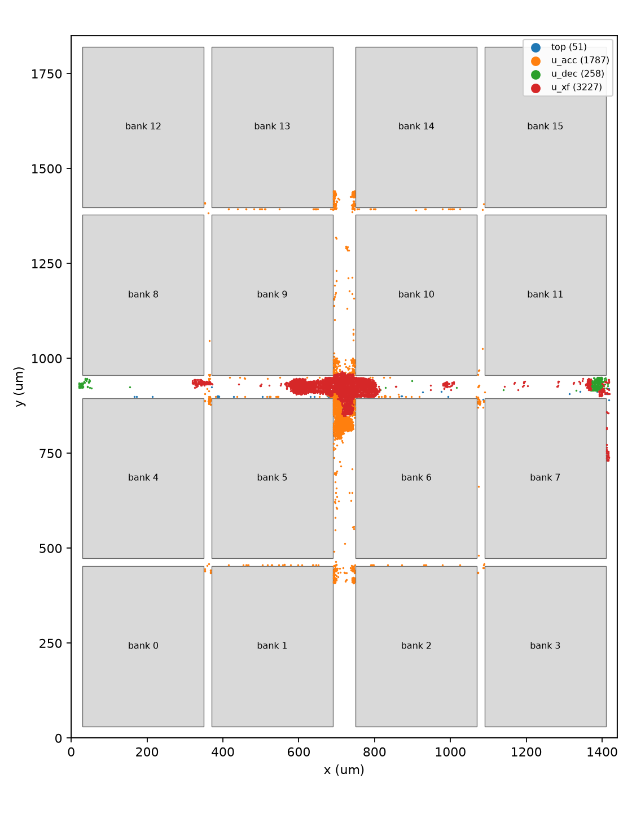

# 5. SRAM과 합성 결과

> [← 이전](04_RTL_구조.md) · [index](index.md) · [다음 →](06_검증과_결과_해석.md)

---

4장의 RTL을 대회 서버에서 합성하고 배치 · 배선한 결과와, 합성하지 않은 월드 메모리 SRAM에 둔 가정치다. 두 종류의 수치는 출처가 달라서
나눠 적는다. 로직 수치는 대회 서버 GPDK045의 합성 및 배치 · 배선 리포트에서 가져오고,
SRAM 수치는 다른 공정(FreePDK45)의 OpenRAM 결과와 CACTI 모델로 만든 가정치다.

### 결과를 읽기 전에: 어떤 작업을 한 것인가

| 단계 | 쉬운 뜻 | 이 프로젝트에서 확인한 것 |
|---|---|---|
| RTL 시뮬레이션 | 하드웨어 설계 코드를 시간 순서대로 동작시켜 봄 | 입력에 따른 메모리 값과 사용 클럭 수 |
| 합성(synthesis) | RTL을 실제 라이브러리의 논리 게이트 · 플립플롭으로 바꿈 | 로직 면적, 경로 지연, 활동도 기반 전력 추정 |
| 배치 · 배선(P&R) | 셀을 칩 위에 놓고 연결 선과 클럭망을 만듦 | 배선 영향을 포함한 타이밍 · 로직 전력, 배치 면적 |
| 실리콘 측정 | 제작한 칩에 입력을 넣고 실제 속도 · 전력을 측정 | 이번 결과에는 포함하지 않음 |

**로직**은 계산과 제어를 하는 회로, **표준 셀**은 합성에 쓰는 기본 게이트와 저장 회로다.
**공정**은 회로를 만드는 기술과 설계 규칙이고, GPDK045는 대회에서 지정한 설계 환경이다.
**코너(corner)**는 공정 · 전압 · 온도 조건의 조합이다. 같은 회로도 조건에 따라 지연과 전력이 달라지므로
수치에는 조건을 함께 적는다. slow는 느리게 동작하는 쪽, fast는 빠르게 동작하는 쪽 조건을 뜻한다.

| 표의 단위 | 뜻 | 비교할 때 보는 점 |
|---|---|---|
| MHz | 초당 백만 번의 클럭 | 그 주파수에서 타이밍 조건을 통과했는가 |
| ns · ps | 10억분의 1초 · 1조분의 1초 | 경로 지연이나 여유 시간 |
| µm² · mm² | 회로가 차지하는 면적 | 로직 셀 면적인지 SRAM 포함 다이 면적인지 |
| mW · µW | 시간당 소비 에너지의 크기인 전력 | 어떤 입력 활동과 조건에서 추정했는가 |
| pJ/이벤트 | 이벤트 한 건을 처리할 때 쓰는 에너지 | 전력뿐 아니라 그동안 처리한 이벤트 수도 반영했는가 |

이하의 전력은 설계 도구가 계산한 추정값이다. **활동 중**은 실제 입력으로 시뮬레이션한 신호 변화량을
도구에 넣었다는 뜻이다. **vectorless**는 그 입력 파형 대신 도구의 활동도 가정을 썼다는 뜻이다.

## 5.1 로직 (GPDK045 합성)

이 표는 계산 · 제어 로직의 결과다. 월드 메모리 SRAM 내부의 면적과 소비 전력을 여기에 넣어 합성한 것은 아니다.

조건은 Genus 23.14, `slow_vdd1v0` 라이브러리, `PVT_0P9V_125C`(0.9 V, 125 °C), 목표 200 MHz, clock gating을 넣은 것이다.

| 항목 | 값 |
|---|---|
| 타이밍 | 200 MHz에서 slack +5.9 ps. 처리율 요구량 111.1 MHz([설계 근거 8절](../reports/01_설계_근거.md#8-같은-칸-업데이트-합치기와-sram-뱅크))에 1.8배 |
| 면적 | 11,081 µm² (셀 4,412개) |
| 전력 | 활동 중(이벤트가 거의 매 클럭) 0.432 mW, vectorless 0.633 mW |
| 이벤트당 로직 에너지 | 2.20 pJ |
| 등가 확인 | Conformal LEC 667점 모두 등가, 넷리스트 시뮬레이션(지연 없음)이 골든과 칸 단위로 같음 |

블록별 면적 · 전력, 방법과 원자료는 [설계 근거 9절](../reports/01_설계_근거.md#9-합성--배치--배선과-기준-설계-비교)에 있다. 이벤트마다 입력을 받는 기준 설계와의
비교(면적 1.91배, 이벤트당 에너지 2.43배)도 거기 있다. 배치 · 배선 뒤 수치는 5.4절이다.

**slack**은 정해진 시간 제한에서 신호 도착이 얼마나 여유 있는지를 뜻한다. 양수이면 시간 안에 들어온다.
목표 주파수 200 MHz는 한 클럭 5 ns다. 여기서 합성 slack이 양수라는 것은 이 목표를 해당 코너와
제약 조건에서 만족했다는 뜻이며, 회로의 최대 동작 주파수를 별도로 끝까지 찾아낸 결과는 아니다.
처리율 요구량보다 주파수가 높은 것과, 한 경로의 slack이 얼마나 큰지는 서로 다른 여유다.

## 5.2 월드 메모리 SRAM (assumptions)

**assumptions**는 여기서 가정한 모델 조건이라는 뜻이다. 대회 공정에는 사용할 SRAM 컴파일러가 없어,
OpenRAM으로 다른 공정의 메모리 외곽 크기를 얻고 CACTI로 접근 에너지 · 누설을 추정했다.
이를 실제 GPDK045 SRAM 측정값처럼 해석하지 않는다.

합성에서는 `wl_sram`의 내부를 게이트로 만들지 않는 **블랙박스(black box)**로 둔다.
도구에는 입력이 언제 필요하고 읽은 값이 언제 나오는지 적은 `.lib` 타이밍 모델을 주고,
배치 · 배선에는 메모리가 차지할 자리와 핀을 적은 `.lef` 외곽 모델을 준다.
이것은 실제 SRAM 내부 회로 전체를 같은 공정으로 완성했다는 뜻과 다르다.

| 항목 | 값 | 근거 |
|---|---|---|
| 구성 | 1RW 뱅크 16개, 뱅크마다 6,132칸 × 13비트 | [4장 4.5절](04_RTL_구조.md#45-월드-메모리-쓰기), [3장 3.4절](03_좌표_변환과_월드_메모리.md#34-월드-메모리) |
| 뱅크 하나의 macro | 4,096 word 하나 + 1,024 word 둘 (13비트, 1RW) | OpenRAM 1.2.48이 만들 수 있는 가장 큰 macro가 4,096 word |
| macro 면적 | 4,096 word 81,376 µm², 1,024 word 24,849 µm² | OpenRAM layout, FreePDK45 ([근거](../../hardware/sram/results/2026-10-28_openram/evidence.md)) |
| SRAM 면적 | 2.10 mm² (16 × (81,376 + 2 × 24,849) µm²) | 위 둘 |
| 읽기 지연 | 1클럭 | RTL 가정(4장 4.5절) |
| 읽기 시간(합성 타이밍용) | 2.0 ns, setup 0.3 ns | OpenRAM 분석 모델 최소 주기 1.40 ns(TT 1.0 V 25 °C)를 slow 코너로 늘려 잡음. 읽기 → 더하기 → 쓰기 경로 여유가 합성 +607 ps, 배치 · 배선 뒤 +279 ps |
| 셀 종류 | 저누설(lstp) | 고성능 셀은 leakage가 뱅크 16개에서 273 mW라 맞지 않음 |
| 접근 에너지 | 4,096 word 읽기 5.41 · 쓰기 3.66 pJ, 1,024 word 읽기 2.19 · 쓰기 2.04 pJ | CACTI 7, 45 nm, 16비트 word로 잡음 ([근거](../../hardware/sram/results/2026-10-28_cacti/evidence.md)) |
| leakage | 61.3 µW (뱅크 16개 합) | 같은 곳 |

SRAM 접근은 이벤트당 1.454회(읽기와 쓰기 합, 장면 1 전체)다. 같은 칸에 이어 오는 이벤트를 합쳐서 2회에서 줄었다
([설계 근거 8절](../reports/01_설계_근거.md#8-같은-칸-업데이트-합치기와-sram-뱅크)).

**읽기 지연 1클럭**은 읽기 명령 뒤 다음 클럭에 데이터를 쓰게 정한 동작 규칙이다. 표의 **읽기 시간 2.0 ns**는
그 클럭 안에서 메모리 출력이 언제 도착한다고 합성 도구에 알려 주는 경로 모델이다. 같은 항목의 다른 단위
표현이 아니다. **leakage(누설 전력)**는 읽고 쓰지 않는 동안에도 전원이 켜져 있으면 소비되는 몫이다.

OpenRAM 면적과 CACTI 에너지는 서로 다른 도구에서 온 모델 값이다. 전체 에너지를 비교하는 근거로 쓸 수
있지만, 이 조합으로 GPDK045 SRAM 자체의 최종 타이밍 · 제조 검증을 마친 것은 아니다.

## 5.3 이벤트당 에너지

장면 1 평균으로 이벤트 하나에 약 9.2 pJ이다. 로직 2.20 pJ(합성), SRAM 동적 5.94 pJ와 SRAM leakage 1.11 pJ(CACTI 가정치)를
더한 추정이다. 로직을 배치 · 배선 뒤 값 3.02 pJ로 바꾸면 약 10.1 pJ다(5.4절). 계산과 기준 설계 비교는 [설계 근거 9절](../reports/01_설계_근거.md#9-합성--배치--배선과-기준-설계-비교)에 있다.

로직의 이벤트당 에너지는 **활동 구간 전력 × 구간 시간 ÷ 그 구간 이벤트 수**로 계산한다.
SRAM 동적 에너지는 읽기 · 쓰기 접근 횟수와 macro별 접근 에너지로 계산하고, 누설 몫은 녹화의 평균
이벤트율에 맞춰 나눈다. 따라서 합계는 정해진 입력 활동과 모델에 따른 추정이다.
모든 장면과 입력률에서 이벤트당 에너지가 같은 상수라는 뜻은 아니다.

## 5.4 배치 · 배선

셀을 배치한 뒤에는 신호를 잇는 선의 길이와 용량이 생긴다. 클럭을 여러 레지스터에 나눠 보내는 버퍼와
너무 빨리 도착하는 신호를 늦추는 버퍼도 필요해진다. 그래서 합성 단계보다 셀 수와 전력이 커질 수 있다.

Innovus 23.14로 5.1절의 넷리스트를 배치 · 배선했다. SRAM 뱅크 16개는 5.2절 크기(뱅크 하나 320.00 × 422.37 µm)의 자리
블록으로 4 × 4로 놓고, 로직은 가운데 십자 통로에 둔다. 셋업은 slow 코너, hold는 fast 코너(`PVT_1P1V_0C`)로 본다.

| 항목 | 값 |
|---|---|
| 타이밍 | 200 MHz에서 셋업 여유 +65 ps, hold 여유 +31 ps. 위반 경로 0 |
| 다이 | 1,440 × 1,851 µm (2.665 mm²), 그중 SRAM 뱅크 자리 81 % |
| 표준 셀 | 5,323개, 13,071 µm² (클럭 · DRV · hold 버퍼 포함) |
| 활동 중 로직 전력 | 0.594 mW, 이벤트당 3.02 pJ (배선 뒤 넷리스트의 게이트 레벨 VCD) |
| 검사 | 전기 규칙 · DRC · 연결 위반 0. LEC 667점 등가, 게이트 레벨 시뮬레이션이 골든과 칸 단위로 같음 |

방법과 해석은 [설계 근거 9절](../reports/01_설계_근거.md#9-합성--배치--배선과-기준-설계-비교)에 있다.

**setup(셋업)**은 신호가 다음 저장 시점보다 충분히 일찍 도착해야 하는 조건이고,
**hold**는 저장 시점 직후에도 잠깐 안정적으로 유지돼야 하는 조건이다.
“타이밍이 닫혔다”는 표현은 여기서 두 조건의 위반이 없다는 뜻이다.
**DRC(Design Rule Check)**는 배선 폭 · 간격 같은 설계 규칙 검사이고, 연결 검사는 이어져야 할 선이
끊기거나 잘못 붙지 않았는지 보는 검사다. 이 결과는 주어진 SRAM 자리 모델을 포함한 배치 · 배선 범위다.

그림의 큰 블록들은 SRAM 뱅크가 들어갈 자리다. 다이 면적은 이 자리와 로직 · 배선 공간을 포함한 전체 외곽이고,
표준 셀 면적은 로직 셀 자체의 면적 합이다. 두 값을 서로 바꿔 인용하지 않는다. SRAM 블록은 실제 내부 배선까지
구현한 그림이 아니라 외곽 크기를 반영한 자리 모델이다.

## 5.5 기준 설계와 무엇을 비교했나

### 이벤트별 입력 회로와의 비교

최종 설계는 `wl_top`, 기준 설계는 `wl_base_top`이다. 기준 설계는 이벤트마다 x · y와 위상을 받고,
각 이벤트마다 CORDIC과 네 곱셈을 계산하도록 만들었다. 연속 입력을 처리하려고 CORDIC을 여러 단계로
펼쳤으므로, 프레임마다 한 번 계산하는 최종 설계보다 계산 회로와 중간 레지스터가 많이 필요하다.

두 설계는 **같은 정수 좌표 계산, 같은 해상도, 같은 회전 입력, 같은 최종 누적 블록과 SRAM 구성**을 쓴다.
같은 GPDK045 코너 · 목표 주파수에서 비교했다. 활동 구간의 이벤트 수가 약간 다르므로 에너지는 각각의
실제 처리 이벤트 수로 나눴다. 원자료는 [최종 합성 근거](../../hardware/syn/results/2026-10-29_pnr/evidence.md)에 있다.

| 항목 | 최종 설계 `wl_top` | 기준 설계 `wl_base_top` | 읽는 법 |
|---|---:|---:|---|
| 합성 로직 면적 | 11,081 µm² | 21,205 µm² | 최종 설계가 기준의 약 52 % |
| 활동 중 로직 전력 | 0.432 mW | 1.054 mW | 각각의 활동 파형을 사용한 추정 |
| 이벤트당 로직 에너지 | 2.20 pJ | 5.33 pJ | 최종 설계가 기준의 약 41 % |
| SRAM까지 포함한 이벤트당 에너지 | 약 9.2 pJ | 약 12.4 pJ | 5.2 · 5.3절의 SRAM 가정을 적용한 합계 |
| 입력 비트/이벤트 | 원본 파일 평균 10.1 | 기준 입력 36 | 아래의 집계 범위를 함께 읽는다 |
| 좌표 변환 곱셈/이벤트 | 장면 1 평균 1.14 | 4.00 | 열 · 묶음 계산 재사용 효과 |

기준 입력의 **36비트는 x 10비트 + y 10비트 + 위상 16비트**다. ON · OFF를 따로 세지 않으므로 극성 포트는
없다. 타임스탬프에서 각도를 구하는 외부 계산도 기준 회로에 넣지 않았다. MGROUP의 10.1은 머리와 시각
워드 등을 포함한 파일 평균이고, 최종 설계에 별도로 공급하는 프레임별 위상은 그 파일 비트 수에 포함되지 않는다.
양쪽 모두 물리 링크의 부호화 · 핸드셰이크 비용까지 포함한 통신 시스템 전체 대역폭 수치는 아니다.

이 비교는 **이벤트마다 계산하는 이번 기준 회로에 비해 입력의 공통 정보를 이용하면 얼마나 줄어드는가**를
보인다. 모든 AER 회로가 매 이벤트마다 삼각함수를 새로 계산해야 한다는 뜻은 아니다. AER 입력을 받더라도
같은 각도를 캐시하거나 별도 최적화를 할 수 있으므로, 결과를 모든 AER 설계에 대한 우열로 넓혀 말하지 않는다.

### 처음 메모리 구조와의 비교

SRAM 면적을 “처음 구조의 38 %”라고 할 때의 비교 대상은 위 기준 회로와 다르다. **처음 검토한 메모리 구성**은
14비트 정사각형 전체를 읽기 · 쓰기 분리 포트로 저장하는 구조였다. 최종 메모리는 13비트 · 원 영역 · 1RW 뱅크를 쓴다.
그 변경에 따른 OpenRAM 가정 면적은 5.51 → 2.10 mm²다. 근거는
[설계 근거 8절](../reports/01_설계_근거.md#8-같은-칸-업데이트-합치기와-sram-뱅크)에 있다.

**로직 비교는 입력과 연산 구조의 차이**, **처음 SRAM과의 비교는 메모리 구성의 차이**다.
기준 회로도 최종 누적 블록을 공유하므로, 두 감소율을 같은 기준의 독립된 개선으로 곱하지 않는다.

### 쓰지 않을 때의 회로 활동 줄이기

**clock gating**은 값을 바꿀 필요가 없는 레지스터에 클럭이 계속 전달되지 않게 하는 방법이다.
같은 로직에서 이를 뺀 회로 `wl_top_nocg`도 합성했다. 그때 활동 중 로직 전력은 0.725 mW로,
적용한 회로의 0.432 mW보다 컸다. 이는 위 입력 형식 비교와 별도로 확인한 효과다.
여러 변경의 영향을 나눠 본 **ablation(요소를 하나씩 빼는 비교)**은
[설계 근거 9절](../reports/01_설계_근거.md#9-합성--배치--배선과-기준-설계-비교)에 있다.
모든 조합을 각각 새로 합성한 것은 아니며, 표마다 로직 리포트 · RTL 클럭 수 · SRAM 모델 중 어떤 근거인지 구분한다.

## 5.6 실시간 처리와 전력 수치를 읽는 법

실시간 처리는 새 프레임이 계속 들어올 때 처리할 일이 끝없이 밀리지 않는다는 뜻이다.
전체 녹화를 나중에 한 번 처리해서 빨리 끝나는지만으로는 부족하다. 이벤트가 몰린 프레임도 시간 안에
처리할 수 있는지 확인해야 한다. 그래서 프레임별 RTL 사용 클럭 수를 프레임 간격으로 나눠 필요한 주파수를 구했다.

장면 1의 처리율 기준 요구량은 111.1 MHz이고, 열 스캔이 두 번 들어 있는 프레임의 요구량은 164.2 MHz다.
목표 200 MHz는 둘 다 넘는다. 집계와 근거는
[설계 근거 7절](../reports/01_설계_근거.md#7-좌표-변환-구조와-처리율)과
[9절](../reports/01_설계_근거.md#9-합성--배치--배선과-기준-설계-비교)에 있다.
이 판단은 해당 입력 · 위상 공급과 SRAM 지연 모델에서 얻은 결과이며, 실제 카메라 링크까지 연결해 잰 지연은 아니다.

활동 중 전력 표는 이벤트가 거의 매 클럭 있는 구간의 값이다. 녹화 중 이벤트가 적거나 입력이 끊기는 시간의
평균 전력과 같다고 보지 않는다. 반대로 이벤트당 에너지는 처리량을 반영하므로 전력만 비교할 때보다
계산 한 건의 비용을 읽기 쉽다. 전체 장치의 전력에는 이 가속기 밖의 센서 · 입력 링크 · 회전각 추정도
들어가지만, 이 장의 로직 · SRAM 합계에는 그 외부 장치를 포함하지 않는다.
