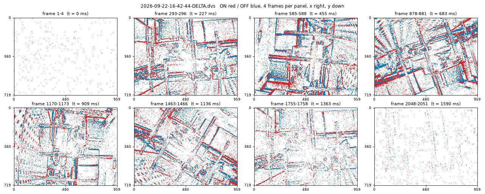
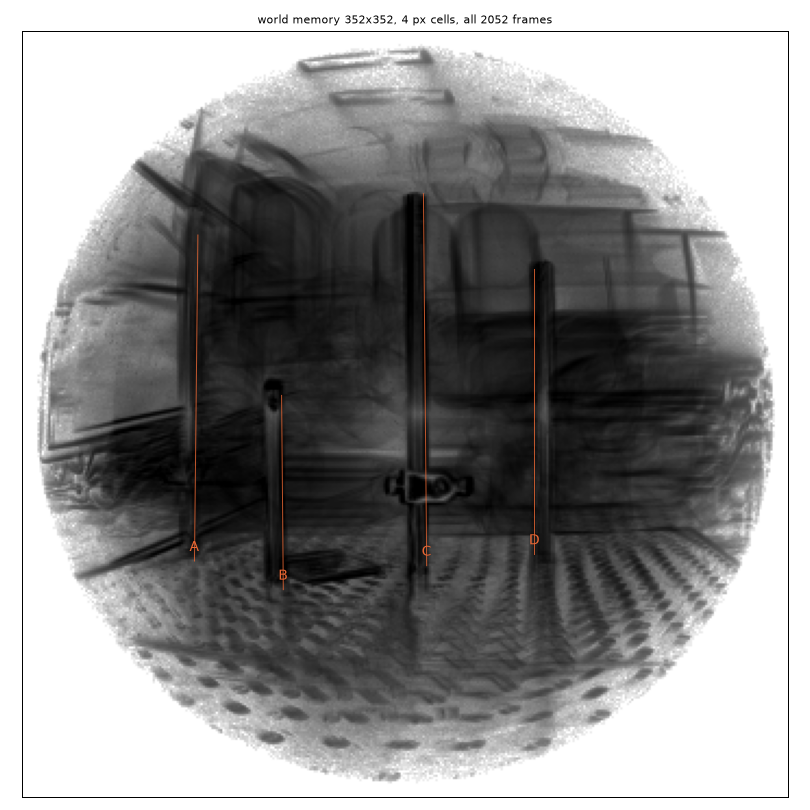

# 6. 검증과 결과 해석

> [← 이전](05_SRAM과_합성_결과.md) · [index](index.md) · [다음 →](07_파일_안내와_재현.md)

---

이 프로젝트의 결과는 두 질문으로 나눠 읽는다. **좌표를 이렇게 옮기면 실제 장면이 잘 모이는가?**
그리고 **설계한 회로가 그 계산을 틀리지 않고 수행하는가?** 첫 질문은 막대의 정렬과 번짐으로,
둘째 질문은 소프트웨어 기준 결과와 메모리 칸을 전부 비교해서 확인했다.
속도 · 면적 · 전력의 정본 수치는 [5장](05_SRAM과_합성_결과.md)에 있다.

## 6.1 무엇과 무엇을 비교했나

| 확인할 질문 | 비교 대상 | 같거나 좋아야 하는 것 | 이 비교로 알 수 있는 것 |
|---|---|---|---|
| 파일을 제대로 읽었나 | 우리 파서와 제조사 SDK | 프레임 · 위치 · 극성의 이벤트 목록 | MGROUP 비트 해석이 제조사 해석과 맞음 |
| 회전을 잘 보정했나 | 짧은 구간, 회전 구간별 지도, 전체 누적 지도 | 막대 방향 · 위치 · 가장자리 폭 | 정지 물체가 대체로 같은 위치에 모이는 정도 |
| 정수화가 얼마나 영향을 주나 | 실수 좌표 계산과 고정소수점 계산 | 좌표 차이와 칸이 달라지는 비율 | 숫자 표현을 줄인 데 따른 오차 |
| RTL 계산이 사양과 같나 | 정수 골든 모델과 RTL 출력 | 모든 월드 메모리 칸의 값 | 회로가 정해진 정수 계산과 누적을 수행함 |
| 도구가 회로를 바꾸며 기능을 깨뜨리지 않았나 | RTL과 합성 · 배치 뒤 넷리스트 | 등가 검사와 시험 벡터 결과 | 변환된 게이트 회로가 RTL 기능을 유지함 |

**골든 모델(golden model)**은 회로가 따라야 할 기준을 소프트웨어로 구현한 것이다.
이 프로젝트의 `golden.py`는 CORDIC, 고정소수점, 칸 나누기, 저장 영역, 포화를 RTL과 똑같이 정의한다.
측정 장비가 알려 준 절대 정답이라는 뜻은 아니다. 같은 모델을 잘못 정했다면 RTL도 같은 잘못된 결과를
낼 수 있으므로, 실제 장면의 막대 측정을 별도로 한다.

## 6.2 결과 그림은 어떻게 읽나

### 입력: 카메라 화면에서 본 이벤트

장면 1 녹화의 여러 시점이다. 작은 화면 하나는 연속한 센서 프레임 4개의 이벤트를 겹쳐 그렸다.
빨간 점은 밝아짐(ON), 파란 점은 어두워짐(OFF), 흰 곳은 그 구간에서 표시할 이벤트가 없는 위치다.
사진의 실제 빨강 · 파랑 색을 복원한 그림은 아니다.

막대와 방의 테두리가 시점마다 돌아 보인다. 카메라가 정지한 구간에서는 이벤트가 적어 희게 보일 수 있다.
희다는 이유만으로 장면에 물체가 없다고 판단하지 않는다. 원본과 그리는 방법은
[입력 해석 근거 묶음](../../software/dvs_data/2026-10-28_dvs_read/2026-10-28_dvs_read.md)에 있다.

### 출력: 회전을 되돌린 뒤 전체를 모은 월드 메모리

이 그림은 최종 장면 1 골든 모델의 `world.npy`를 표시한 것이다. **진한 칸일수록 이벤트가 많이 쌓였다.**
작은 값과 큰 값을 함께 볼 수 있게 로그 눈금과 명암 조정을 썼으므로, 화면의 진하기가 이벤트 수에 그대로
비례하지는 않는다. 밝기 사진을 복원한 결과도 아니다.

주황색 선 A ~ D는 막대의 한쪽 가장자리를 측정한 위치 표시다. 선이 서 있는 방향과 막대가 모인 모습을
볼 수 있다. 원 모양 외곽은 센서 시야를 회전시켜 누적한 범위와 저장 영역에서 온다.
이 결과 메모리가 RTL 출력과 칸별로 같다는 것은 6.4절의 별도 시험으로 확인했다.

원본 그림과 측정 자료는 [최종 장면 1 골든 묶음](../../software/golden_data/2026-10-28_golden_bar_center/2026-10-28_golden_bar_center.md)에 있다.
이 그림은 정렬을 눈으로 살펴보는 자료이고, 성능을 판단할 때는 아래 측정을 함께 본다.

## 6.3 막대가 잘 모였다는 것은 어떻게 판단했나

녹화에는 프레임별 정답 회전각이나 정답 월드 위치가 없다. 대신 **실제로 수직으로 세워 둔 막대**를 기준으로
삼았다. 회전이 거의 없는 짧은 구간을 기준 지도로 만들고, 같은 설정으로 녹화 전체를 누적해 비교했다.
짧은 구간도 같은 모델로 만든 상대 비교 기준이므로 절대 정답 좌표는 아니다.

| 지표 | 쉬운 뜻 | 해석할 때의 한계 |
|---|---|---|
| 막대 기울기 | 수직에서 몇 도 기울었나 | 지도의 전체 방향 보정 α도 영향을 준다 |
| 가로 위치 차이 | 짧은 구간과 전체에서 잡힌 막대 가장자리가 얼마나 옆으로 움직였나 | 전체 지도끼리의 차이와 구간별 흔들림은 다르다 |
| 구간별 위치 · 기울기 | 회전 구간을 나눠도 막대가 같은 곳에 서 있나 | 특정 구간에서 남는 오차를 전체 평균이 가릴 수 있다 |
| 가장자리 반치폭 | 테두리 이벤트가 가로로 얼마나 퍼졌나 | 막대의 실제 두께나 지름을 잰 값은 아니다 |

**반치폭(FWHM)**은 봉우리의 절반 높이 이상인 부분의 폭이다. 막대 가장자리에 수직인 방향으로 이벤트 수를
읽으면 테두리 위치에 봉우리가 생긴다. 주변 배경 값을 뺀 뒤 그 봉우리가 얼마나 넓은지 잰다.
같은 조건에서 폭이 커지면 여러 시점의 테두리가 더 퍼져 쌓였다고 볼 수 있다.

장면 1의 최종 측정은 다음과 같다. 출처는 [verify.txt](../../software/golden_data/2026-10-28_golden_bar_center/verify.txt)다.

| 막대 | 전체 누적 기울기 | 짧은 구간 대비 전체의 가로 위치 차이 | 가장자리 반치폭: 짧은 구간 → 전체 |
|---|---:|---:|---:|
| A | −0.6° | 0 px | 12 → 24 px |
| B | +0.5° | +1 px | 4 → 12 px |
| C | +0.5° | −1 px | 4 → 8 px |
| D | 0.0° | +2 px | 8 → 12 px |

전체 지도와 짧은 구간의 위치 차이는 한 칸 안에 있고, 전체 누적 막대의 기울기는 수직에 가깝다.
다만 회전 구간끼리 따로 보면 가로 위치의 최대 · 최소 차이가 A 15, B 7, C 9, D 10 px다.
**모든 시점의 모든 이벤트가 정확히 한 점으로 겹쳤다는 결과는 아니다.** 가장자리 폭도 전체 누적에서 늘어난다.

남은 번짐은 회전 중심이 물체 거리마다 다른데 하나의 중심으로 처리하는 점과 관련이 있다.
가까운 막대에 잘 맞춘 중심이 먼 배경까지 똑같이 맞추지는 못한다.
중심 선택을 바꾼 효과와 렌즈 보정을 채택하지 않은 이유는
[설계 근거 2절](../reports/01_설계_근거.md#2-회전-중심과-회전각-추적)과
[3절](../reports/01_설계_근거.md#3-렌즈-보정)에 있다.

## 6.4 회로가 맞게 계산한다는 것은 어떻게 확인했나

### 1단계: 입력 해석을 먼저 맞춤

제조사 SDK가 읽은 이벤트와 우리 파서가 읽은 이벤트를 프레임 · x · y · 극성으로 정렬해 비교했다.
같은 이벤트의 중복 개수도 포함해 비교했고, 파일 안에 나열된 순서 자체는 일치 조건으로 삼지 않았다.
세 녹화에서 이 목록이 일치했다. 프레임 시각의 SDK 대조는 따로 보고하는 항목이므로,
파서 비교 프로그램의 성공 여부만으로 모든 이벤트의 세부 시간까지 일치했다고 넓혀 말하지 않는다.
근거는 [입력 해석 결과](../../software/dvs_data/2026-10-28_dvs_read/2026-10-28_dvs_read.md)에 있다.

### 2단계: CORDIC과 RTL 최종 메모리 비교

CORDIC은 입력 가능한 위상 전체에 대해 SW 정수 모델과 RTL 출력 C · S를 비교했다.
전체 회로는 MGROUP 워드와 위상을 넣고 처리가 끝난 뒤 월드 메모리를 읽어 `expected.hex`와 비교했다.
최종 합계만 비교하면 서로 다른 칸의 오류가 상쇄될 수 있으므로 **정사각형 전체 주소의 칸 값을 하나씩 비교**했다.
실제 SRAM에 없는 주소도 0이어야 한다.

장면 1은 잘라 낸 기본 구간뿐 아니라 녹화 전체를 Verilator와 xsim 두 시뮬레이터로 확인했다.
두 도구에서 메모리 불일치가 없었다. 결과와 버전은
[RTL 검증 근거](../../hardware/sim/results/2026-10-28_bar_center/evidence.md)에 있다.

### 3단계: 잘 틀리는 경계 상황을 따로 시험

| 시험 | 무엇을 확인했나 |
|---|---|
| 입력 워드 사이에 빈 클럭을 넣음 | 연속 입력이 끊겨도 작업과 값이 유지되는가 |
| 칸 비트 수를 줄임 | 최댓값에서 정확히 포화하고 0으로 돌아가지 않는가 |
| 합치기를 끄거나 모을 개수를 줄임 | SRAM 접근 횟수는 달라도 최종 칸 값은 같은가 |
| 회전 중심을 멀리 옮김 | 저장 영역 밖 이벤트를 골든과 똑같이 버리는가 |
| 열 주소 없이 시작하는 파일 첫 구간 | SDK · 파서와 같은 초기 x 규칙을 쓰는가 |
| 프레임 카운터가 뛰는 구간 | 프레임과 위상 순서가 밀리지 않는가 |
| 빈 프레임을 끼워 넣음 | 이벤트가 없어도 위상을 다음 프레임으로 넘기는가 |
| 같은 칸에 이어 오는 이벤트 | 합치기와 같은 뱅크 충돌 대기 중 누적값이 사라지지 않는가 |

이 시험들을 한꺼번에 다시 돌리는 것이 **회귀 시험(regression)**이다. 현재 `regress.sh`는 16개를 실행한다.
보관한 `result.txt`는 빈 프레임 시험을 넣기 전 15개이고, 그 시험 결과는 `empty_frames.txt`에 따로 있다.
검사 개수만 보지 말고 실제로 포함한 입력과 조건을 함께 본다.

장면 1 전체에서 범위 밖으로 버린 이벤트는 없다. 하지만 포화한 칸 12개에서 최댓값을 넘은 이벤트 9,285건은
추가로 세지 못한다. **포화 사양대로 계산한 결과가 골든과 같다는 것**이므로, 이 현상은 RTL 불일치가 아니다.
13비트를 고른 비교 근거는 [설계 근거 5절](../reports/01_설계_근거.md#5-칸-비트)에 있다.

### 4단계: 합성 · 배치 뒤 회로도 다시 확인

**넷리스트(netlist)**는 도구가 만든 게이트와 연결 목록이다. **LEC(Logical Equivalence Checking)**는
그 회로와 원래 RTL의 기능이 같은지 형식적으로 비교하는 검사다. **게이트 레벨 시뮬레이션(GLS)**은
넷리스트에 시험 입력을 실제로 넣어 돌리는 검사다. 서로 다른 방식으로 기능을 확인한다.

합성 뒤와 배치 · 배선 뒤 넷리스트 모두 LEC를 통과했고, 기본 시험 구간을 넣은 GLS의 월드 메모리도
골든과 같았다. 세부 결과는 [5장 5.1절](05_SRAM과_합성_결과.md#51-로직-gpdk045-합성),
[5.4절](05_SRAM과_합성_결과.md#54-배치--배선),
[최종 검증 근거](../../hardware/syn/results/2026-10-29_pnr/evidence.md)에 있다.

이 GLS는 **zero delay**, 즉 게이트 지연을 넣지 않은 기능 시험이다. 배선 지연을 넣은 SDF 시뮬레이션을
통과했다는 주장과 구분한다. 시간 조건은 별도의 타이밍 분석으로 확인했고, SRAM 내부는 제공한 블랙박스
모델의 범위에서 다뤘다. 또한 전체 녹화 시험은 RTL에서, 넷리스트 GLS는 잘라 낸 구간에서 했다는 범위 차이가 있다.

## 6.5 다른 녹화에는 어디까지 적용했나

| 입력 | 한 일 | 현재 설계에 포함되는 범위 |
|---|---|---|
| 장면 1: 주 대상 roll | 중심 · 각도 추정, 전체 RTL 검증, 합성 · 배치 · 배선, 기준 회로 비교 | 최종 결과의 주 근거 |
| 장면 2: 회전판 | 그 장면에 맞는 중심과 위상을 넣고 같은 RTL로 전체 검증 | 회로를 바꾸지 않고 입력 설정으로 처리 |
| 9/15: yaw | 렌즈 왜곡과 원통면 월드의 SW 정수 모델 · 시험 벡터 | 현재 `wl_top`의 지원 기능에는 포함하지 않음 |

장면 2는 막대 기준 회전 중심을 고르면 배경 기준보다 일부 막대가 좁게 모인다. 그래도 막대마다 가장 잘 맞는
중심이 달라 전체 번짐을 없애지는 못했다. 프레임마다 중심을 바꾸는 방법도 실험했지만 선택한 지표가 개선되지
않아 최종 설계에는 넣지 않았다. 설정값은 [3장 3.5절](03_좌표_변환과_월드_메모리.md#35-장면-1-설정값),
정렬 품질과 처리 시간은 [설계 근거 10.1절](../reports/01_설계_근거.md#101-장면-2-회전판),
회로 검증은 [장면 2 RTL 근거](../../hardware/sim/results/2026-10-29_scene2/evidence.md)에 있다.

yaw에서는 화면을 평면 안에서 돌리는 것만으로 맞지 않았다. 렌즈 왜곡을 포함해 방향을 원통면에 옮기는
별도 SW 모형을 시험했다. 이 결과는 확장 가능성을 보는 자료이고, 주 대상 roll 회로의 합성 결과로
계산한 것이 아니다. [설계 근거 10.2절](../reports/01_설계_근거.md#102-915-녹화-수평-회전)에 방법과 결과가 있다.

## 6.6 결과를 설명할 때 지켜야 할 범위

이 설계가 보여 준 것은 **주어진 위상과 고정 중심으로 이벤트 좌표를 변환해, 기준 정수 모델과 같은 누적 결과를
내면서 반복 계산과 SRAM 비용을 줄일 수 있다는 것**이다. 실제 장면에서는 막대 정렬 지표로 이 변환이 유용한지 확인했다.

회전각 추정의 정확도까지 회로가 보장하지는 않는다. 센서가 이동하거나 물체의 깊이가 다르면 하나의 평면
회전 모형에 오차가 남는다. 움직이는 물체의 검출 · 분리 기능도 구현하지 않았다.
장면 1 roll에서 렌즈 보정이 도움이 없었다는 결과를 yaw나 다른 렌즈까지 일반화하지 않는다.

로직의 도구 결과와 SRAM 모델을 합친 값은 설계 비교를 위한 추정이고, 제작 칩 전체의 실측값은 아니다.
이 범위를 함께 설명해야 [5장](05_SRAM과_합성_결과.md)의 수치가 무엇을 입증하는지 정확히 전달할 수 있다.
