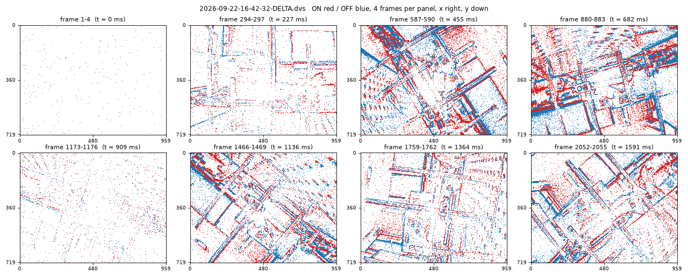
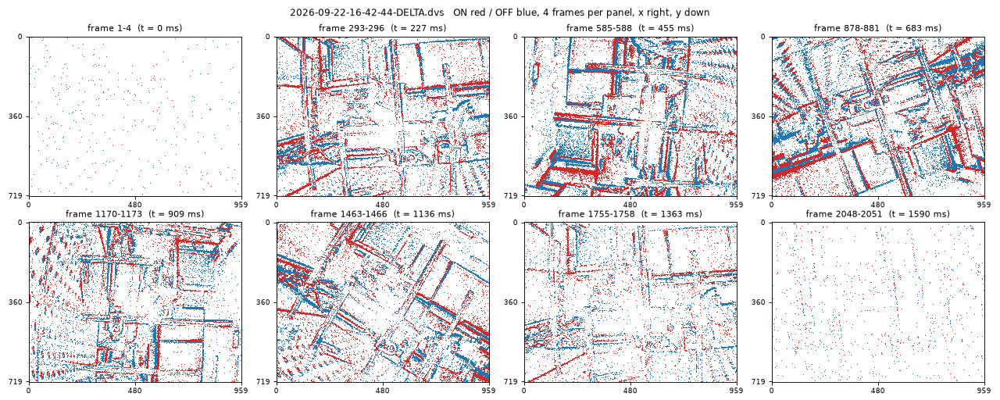
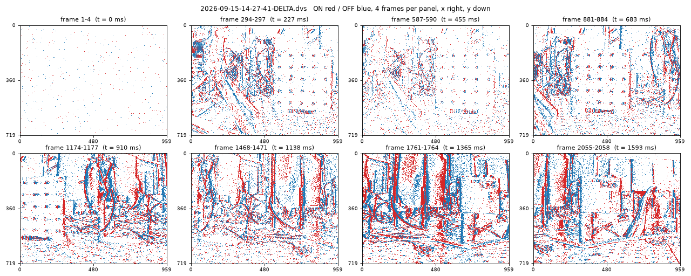
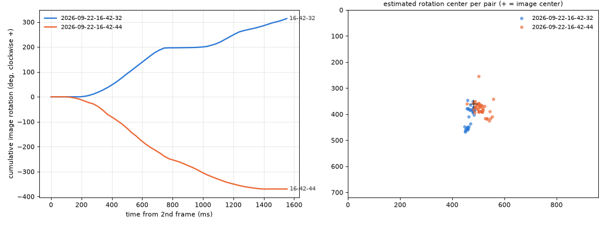

# 2026-10-28 입력 데이터 해석 근거

[설계 근거 1절](../../../docs/reports/01_설계_근거.md#1-입력-해석)의 원자료다. 코드는 `software/dvs_develop/`에 있고
모두 개발 서버에서 2026-10-28에 돌렸다. SDK는 `software/delta_sdk/Linux/x64/libDELTA_SDK.so`다.

| 파일 | 만든 도구 | 내용 |
|---|---|---|
| [summary.txt](summary.txt) | `dvs_read.py` | 녹화별 프레임 수, 이벤트 수, 프레임 간격, 머리 태그 |
| [sdk_check.txt](sdk_check.txt) | `sdk_dump` + `check_sdk.py` | 파서와 SDK의 프레임 수 · 이벤트 수 · 이벤트 집합 비교, 시각이 다른 프레임 목록 |
| `frames_<녹화>.png` | `plot_frames.py` | 녹화마다 여덟 시점, 연속 4프레임을 겹친 이벤트 영상 |
| `roll_<녹화>.csv` | `roll_check.py` | 40프레임 간격 쌍마다 회전 각도와 회전 중심 |
| [roll.png](roll.png) | `roll_check.py` | 두 9/22 녹화의 누적 회전과 회전 중심 |

## 그림

장면 2 (`2026-09-22-16-42-32`)

장면 1 (`2026-09-22-16-42-44`)

9/15 녹화 (`2026-09-15-14-27-41`)

누적 회전과 회전 중심

## Q&A 영상에서 본 것

9/22 Q&A 영상(주최 측 자료)에서 Viewer 파일 이름 칸을 잘라 보았다.

| 시각 | 열린 파일 | 출제자 발언(자막) |
|---|---|---|
| 1:33 | `2026-09-22-16-42-32-DELTA.dvs` | "이게 한 바퀴 도는 겁니다." 화면 FPS 1294 |
| 2:05 | `2026-09-22-16-42-44-DELTA.dvs` | "마찬가지로 한 바퀴 도는데 좀 다르게 돌 거예요." (1:59) |
| 7:22 | `2026-09-22-16-42-44-DELTA.dvs` | "그래서 이거는 거의 제자리에서 논 것 같죠." (7:20) |
| 11:03 | (자막만) | "제자리에서 거의 제자리에서 회전하는 것도 있고 크게 돌면서 회전하는" |
