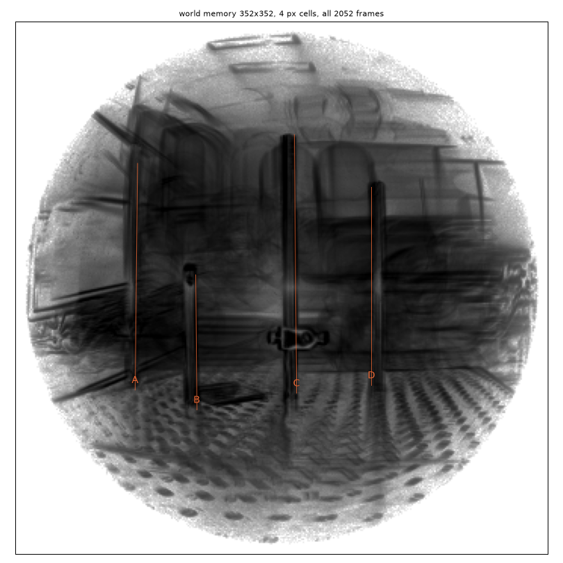
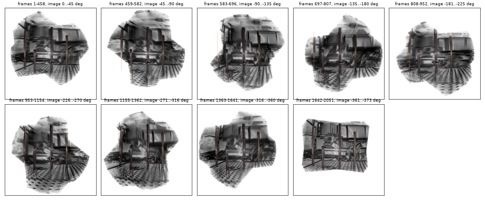

# 2026-10-28 SW 골든 모델 (막대 중심 추적)

설계가 쓰는 골든 모델 묶음이다. 앞의 [2026-10-28_golden_model](../2026-10-28_golden_model/2026-10-28_golden_model.md)과
다른 점은 회전각을 배경 중심 (500, 365)이 아니라 막대 중심 (533, 418)으로 추적한 것 하나다. 그렇게 바꾼 까닭은
[설계 근거 2절](../../../docs/reports/01_설계_근거.md#2-회전-중심과-회전각-추적)에 있다.
막대 구간 기울기의 폭이 B · C · D에서 4.2 ~ 5.9°에서 1.7 ~ 1.9°로 줄고, 전체 누적 기울기가 네 막대 모두 0.6° 안이다.
칸 비트(13)와 저장 영역(반지름 696 px)은 지금 `golden.py`의 값이다. 녹화는 장면 1(`2026-09-22-16-42-44-DELTA.dvs`)이고
개발 서버에서 2026-10-28에 만들었다.

    DVS=software/datasets/2026-09-22-16-42-44-DELTA.dvs
    E=software/golden_data/2026-10-28_golden_bar_center
    python3 software/golden_develop/track_center_check.py $DVS software/golden_data/2026-10-28_golden_model $E <임시 폴더>
    python3 software/golden_develop/golden.py $DVS $E
    python3 software/golden_develop/verify_world.py $DVS $E

`track_center_check.py`는 앞 묶음의 `center.txt`(막대 중심)를 읽어 회전각을 다시 추적하고 위쪽 보정 α를 다시 구한다.
`<임시 폴더>`에는 두 추적의 각도 차(`track_center.txt`)가 쓰이는데, 같은 내용이 [2026-10-28_lens_axis](../2026-10-28_lens_axis/2026-10-28_lens_axis.md) 근거 묶음에 있어 여기 두지 않았다.
세 단계 합쳐 약 1분이다.

| 파일 | 만든 도구 | 내용 |
|---|---|---|
| `rotation.csv` | `track_center_check.py` | 프레임마다 영상 회전각 θ (frame, t_us, theta_deg) |
| [center.txt](center.txt) | `track_center_check.py` | 회전 중심 (533, 418)과 위쪽 보정 α = −6.733° |
| `phase.csv` | `golden.py` | 프레임마다 월드 회전각 ψ, 위상, CORDIC cos · sin |
| `world.npy` | `golden.py` | 전체 2,052프레임을 누적한 월드 메모리(352 × 352, 13비트 포화, 저장 영역 밖은 0) |
| `vectors/` | `golden.py` | 프레임 500 ~ 539의 RTL 테스트벤치 벡터. 수는 [params.txt](vectors/params.txt) |
| [verify.txt](verify.txt) | `verify_world.py` | 막대 기울기 · 위치 · 가장자리 폭, 45° 구간별 비교, 고정소수점 오차, 칸 비트 수별 포화 |
| `world.png` · `segments.png` · `profiles.png` · `rotation.png` | `verify_world.py` | 앞 묶음과 같은 그림 |

확인한 것

- `verify.txt`의 막대 수치([1] ~ [4])가 2026-10-28_lens_axis에서 다른 개발 서버가 같은 방법으로 낸
  [verify_post_center.txt](../2026-10-28_lens_axis/verify_post_center.txt)와 같다. 다른 것은 [5]의 전체 이벤트 수(88,065,850 대
  88,075,135)인데, 이 묶음의 `world.npy`가 13비트에서 포화한 칸 12개의 넘친 이벤트 9,285개를 잘라 담았기 때문이다.
- 시험 벡터의 `words.hex`는 앞 묶음과 같다(같은 프레임의 원시 워드). `phase.hex` · `trig.hex` · `expected.hex`가 바뀐다.

## 그림

