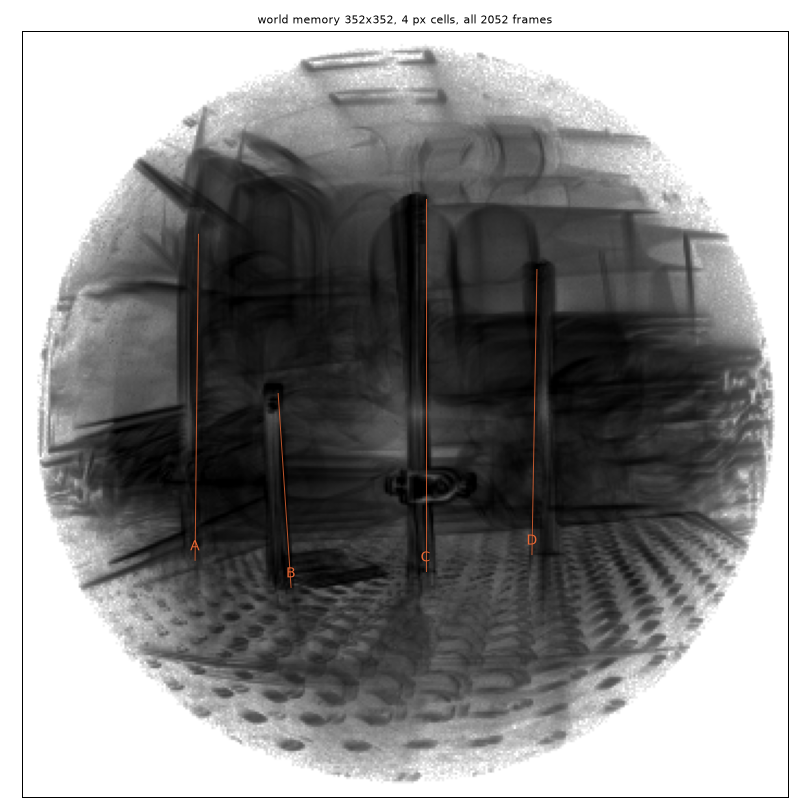
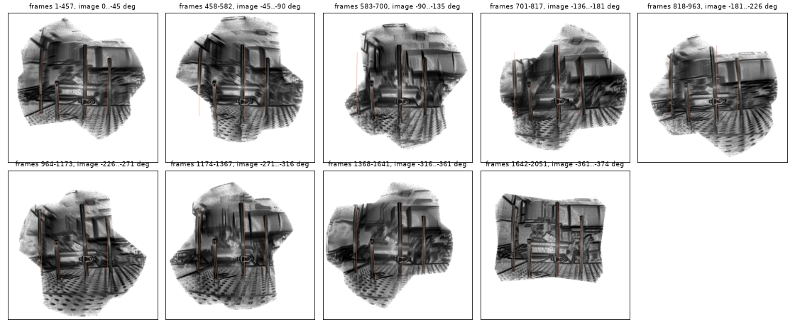
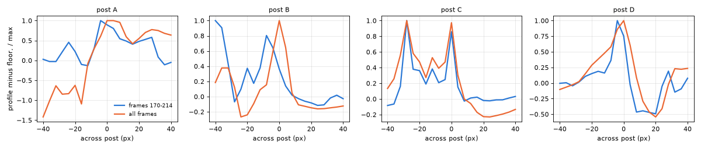
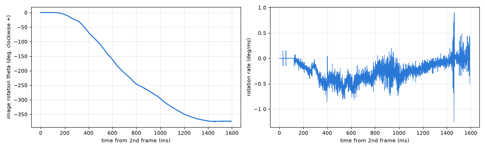

# 2026-10-28 SW 골든 모델 근거

[설계 근거 2절](../../../docs/reports/01_설계_근거.md#2-회전-중심과-회전각-추적)의 원자료다. 녹화는 장면 1(`2026-09-22-16-42-44-DELTA.dvs`)이고,
코드는 `software/golden_develop/`에 있다. 모두 개발 서버에서 2026-10-28에 돌렸다.

| 파일 | 만든 도구 | 내용 |
|---|---|---|
| `rotation.csv` | `track_rotation.py` | 프레임마다 영상 회전각 θ (frame, t_us, theta_deg) |
| [center.txt](center.txt) | `track_rotation.py` | 배경 · 막대 회전 중심, 막대별 최적 중심, 막대 기울기, 위쪽 보정 α |
| `phase.csv` | `golden.py` | 프레임마다 월드 회전각 ψ, 위상, CORDIC cos · sin |
| `world.npy` | `golden.py` | 전체 2,052프레임을 누적한 월드 메모리(352 × 352, uint16) |
| `vectors/` | `golden.py` | 프레임 500 ~ 539의 RTL 테스트벤치 벡터. 형식은 [3장 3.6절](../../../docs/design_references/03_좌표_변환과_월드_메모리.md#36-rtl-테스트벤치-벡터), 수는 [params.txt](vectors/params.txt) |
| [verify.txt](verify.txt) | `verify_world.py` | 막대 기울기 · 위치 · 가장자리 폭, 45° 구간별 비교, 고정소수점 오차, 칸 비트 수별 포화 |
| `world.png` 외 그림 3장 | `verify_world.py` | 아래 |

## 그림

전체 누적 월드 메모리. 주황 선은 막대 선 찾기가 잡은 가장자리다.

영상 회전 45° 구간마다 따로 누적한 월드 메모리. 주황 선은 전체 누적에서 잡은 선이다.

막대 단면. 파랑은 회전이 거의 없는 프레임 170 ~ 214, 주황은 전체 누적이다.

영상 회전각과 회전 속도

